# BabaHakim

**AI-assisted tongue-image health platform for Traditional Persian Medicine — a patient uploads a tongue photo, AI drafts an assessment, and two experts plus a doctor review every case before anything reaches the patient.**

> **Status: Production-capable core, pre-launch.** The clinical workflow, identity, shop, tickets and reporting are implemented end-to-end and covered by 632 automated tests and a 45-scenario pentest; a hardened Docker image is built and scanned in CI. It has **not** been deployed to real patients. The AI model is a rule-based image heuristic (a seam for a trained model, not a validated diagnostic tool), and real SMS / payment delivery needs provider credentials. See [`KNOWN_ISSUES.md`](KNOWN_ISSUES.md).

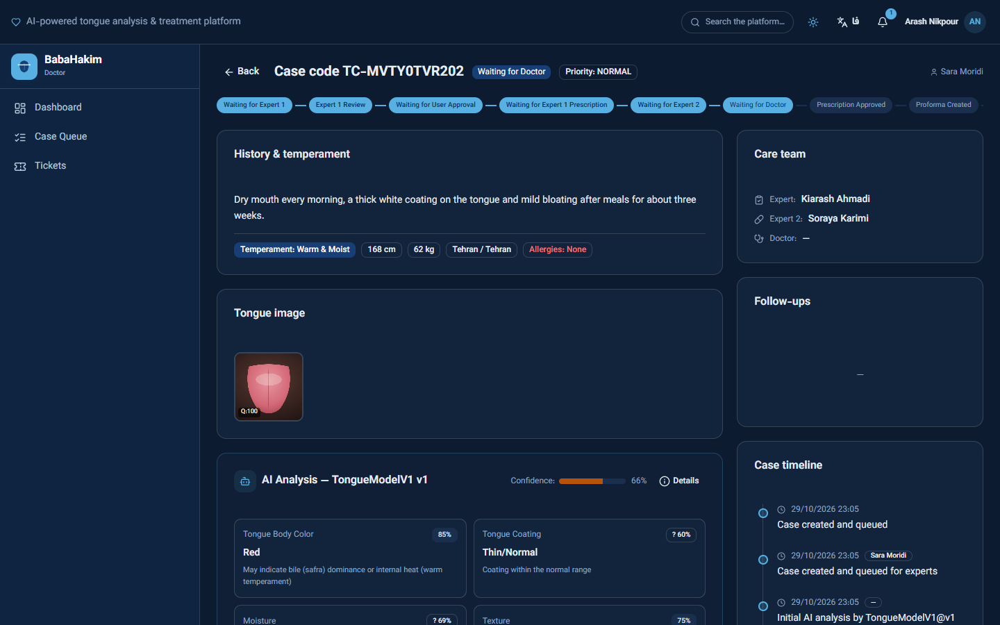

## Problem
Traditional Persian Medicine (TPM) clinics assess a patient's temperament (*mizaj*) and tongue by hand, on paper or chat apps. Cases get lost between the first assessor, the reviewer and the doctor; nobody can tell who changed a prescription or why; and patient data — including national IDs and medical photos — ends up in unaudited places.

## Solution
BabaHakim turns that process into an auditable workflow. Patients register (with their national ID), complete an optional temperament questionnaire and upload tongue images. An AI pass annotates the image with confidence scores; Expert 1 writes the assessment and prescription, Expert 2 checks availability and price (or sends it back), and a doctor approves or rejects. The patient then confirms a proforma, pays and receives the order — and every step is recorded.

## Features (built)
- **Identity** — national-ID login (checksum-validated, stored only as AES-256-GCM ciphertext + HMAC blind index); family members may share one mobile; admin-only national-ID changes with reason and audit; account-bound password recovery.
- **Patient profile** — age *or* birth date (Jalali picker, no fabricated dates), searchable province/city, medical history.
- **Temperament questionnaire** — optional and resumable; partial answers clearly marked incomplete; every response stores the questionnaire and scoring-algorithm version. Admin editor for questions, 2–10 options, scores, weights, required flags and categories.
- **Clinical workflow** — a declarative state machine for case → prescription → proforma → payment → shipment → follow-up. Expert 2 edits create a new immutable prescription version; returns and doctor rejections send the case back for revision instead of closing it.
- **Prescribing tools** — server-side product search, admin-managed dose / frequency / duration / warning vocabulary, ambiguity guard (dose without frequency).
- **Case management** — staff case table with patient identity columns, work-queue / date / priority filters, server pagination, archive and restore (never a delete).
- **Shop & payments** — server-side pricing, invoice price snapshots, Zarinpal gateway with server-side verification, card-to-card receipts with operator approval.
- **Support & reporting** — patient tickets with staff replies; 19 reports with CSV (formula-injection safe), XLSX and PDF export.
- **Bilingual** — Persian (RTL) and English (LTR) throughout, light and dark themes.

## Screenshots
| Landing page | Sign-in (national ID as username) |
|---|---|
| 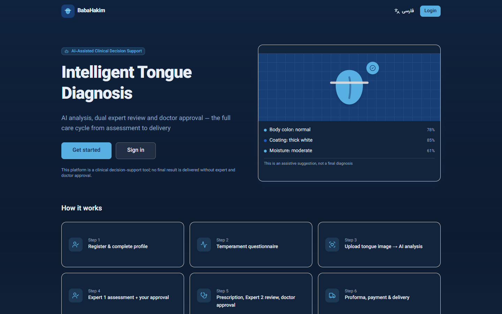 | 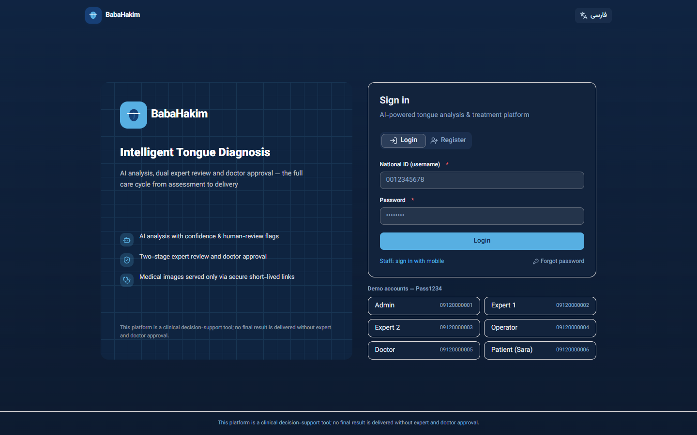 |
| **Patient dashboard** | **Staff case queue** |
| 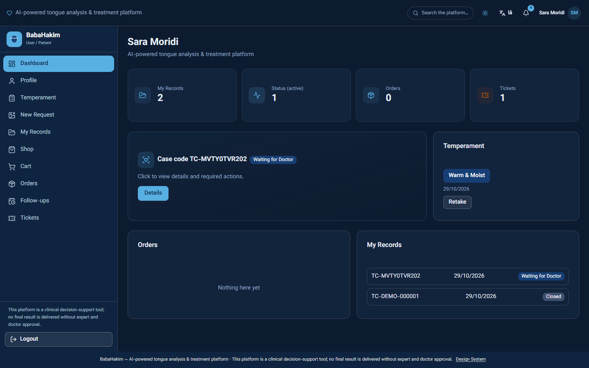 | 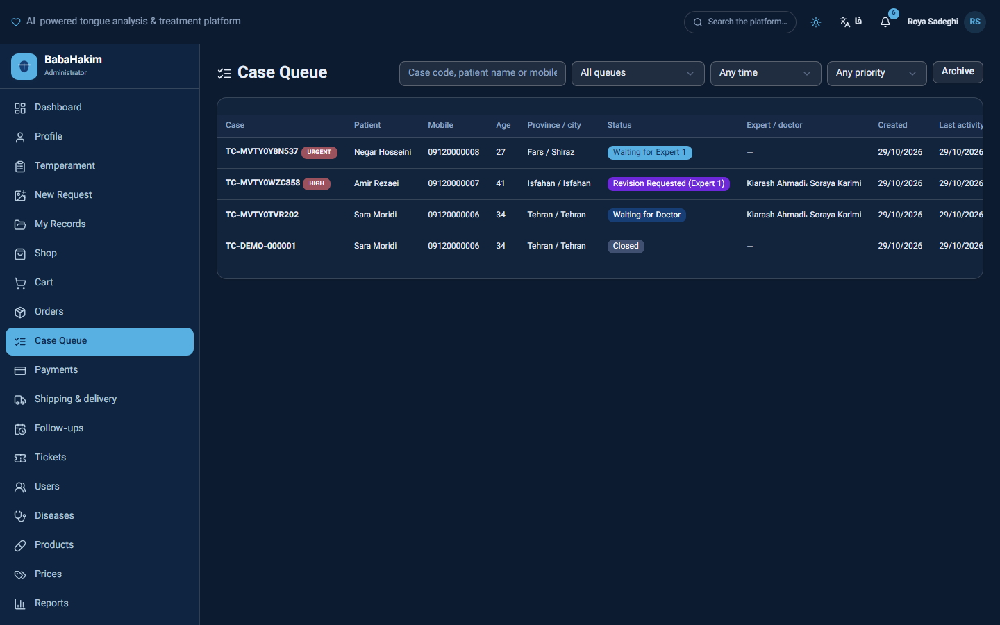 |
| **Case returned to Expert 1** | **Administrator dashboard** |
| 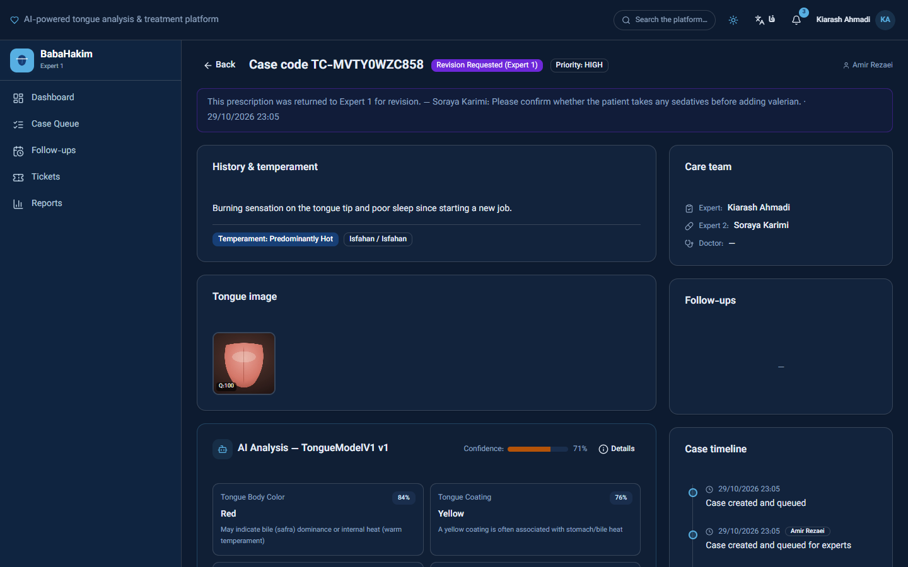 | 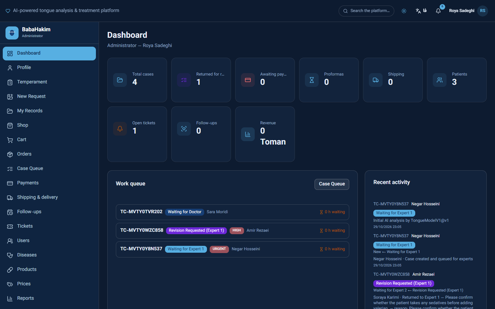 |
| **Temperament questionnaire** | **Questionnaire editor (admin)** |
| 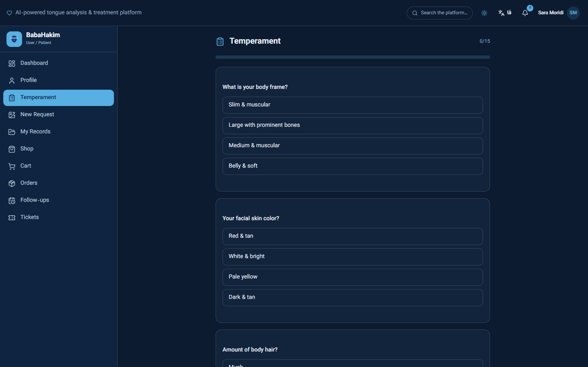 | 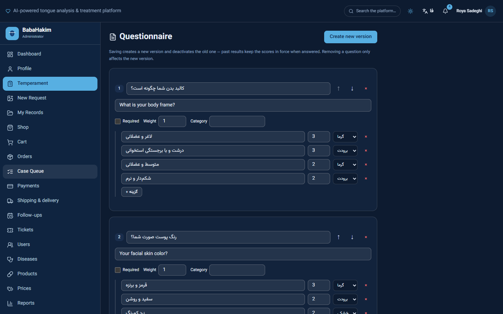 |
| **Shop** | **Support tickets** |
| 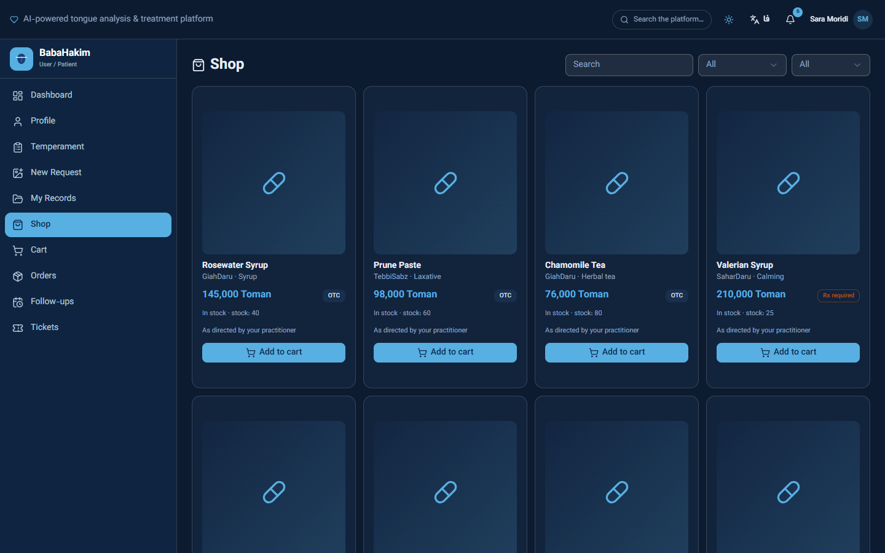 | 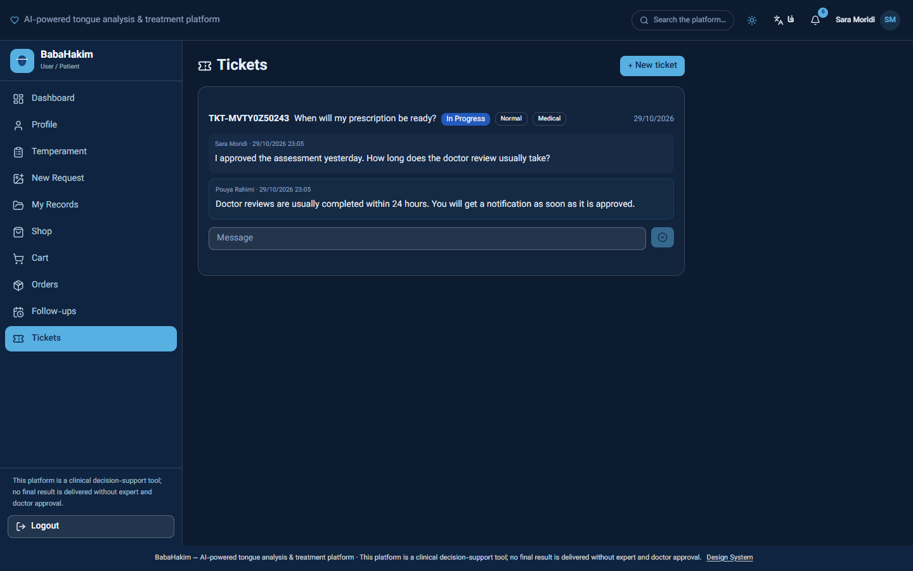 |
| **Reports center** | |
| 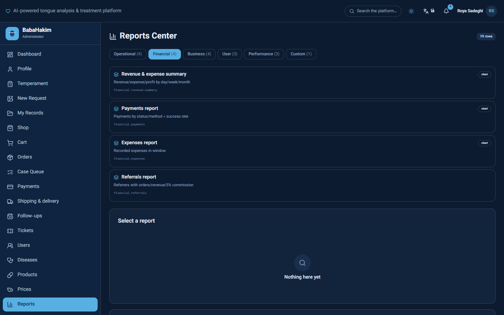 | |

<p>
  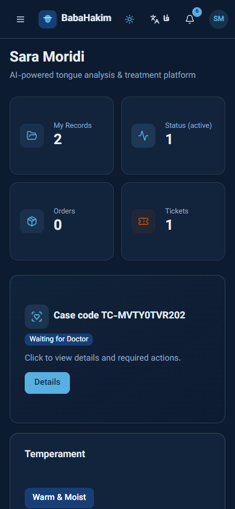
</p>

*Phone-sized screen (390 px wide).*

_Captured from a local run in English and the dark theme. Every person, case, ticket and product is synthetic demo data (generated by `bun prisma/seed.ts` and [`scripts/screenshot-demo-flow.ts`](scripts/screenshot-demo-flow.ts)); the tongue picture is a rendered illustration, not a patient photo. The UI defaults to Persian (RTL) and a light theme._

## Architecture
A single Next.js 16 application (App Router, standalone output) serving both the SPA and a versioned REST API (`/api/v1`). Route handlers are thin; business rules live in application services and a declarative workflow engine that writes the status change, timeline event, audit row and work-queue projection in one transaction. Data is Prisma + SQLite (WAL) with versioned migrations; background work (AI analysis, notifications, retention) runs on a database-backed durable job queue in the same process. Details: [`docs/ARCHITECTURE.md`](docs/ARCHITECTURE.md), [`docs/WORKFLOW.md`](docs/WORKFLOW.md).

## Tech stack
Next.js 16 · React 19 · TypeScript · Tailwind CSS 4 · shadcn/ui (Radix) · Prisma 6 + SQLite · Bun 1.4 · Zod · sharp · pdfkit · Docker (non-root, tini) · nginx · GitHub Actions (lint, type-check, unit + integration tests, pentest, gitleaks, semgrep, bun audit, Trivy).

## Demo instructions
```bash
bun install
bun run db:migrate:safe    # creates/updates the SQLite database from migrations
bun prisma/seed.ts         # DEMO data only: accounts 09120000001–6 / Pass1234
bun run dev                # http://localhost:3000
```
Use the demo-account buttons on the sign-in page to switch roles. The demo seed refuses to run when `NODE_ENV=production`.

## Installation / environment variables
Copy `.env.example` → `.env` for development. Production needs `JWT_SECRET` and `FIELD_ENC_KEY` (the server refuses to start without them) — generate with `bash scripts/gen-secrets.sh`. The full production path (Docker, first-admin bootstrap, TLS, moving existing data) is in [`docs/en/PRODUCTION-DEPLOYMENT.md`](docs/en/PRODUCTION-DEPLOYMENT.md) and [`.env.production.example`](.env.production.example).

## Testing
Integration tests drive a live server on port 3000 and **write to its database** — always run them against a copy:
```bash
bun run dev:testdb         # dev server bound to the database in .env.test-server (refuses the live one)
bun run test:all           # unit + integration + regression against the same copy
bash tests/security-pentest.sh
```

## Project structure
```
babahakim/
├── src/
│   ├── app/api/v1/        REST route handlers (thin controllers)
│   ├── server/            application services, DTOs, audit, events, jobs, media, reporting
│   ├── lib/workflow/      declarative state machines, engine, work queues
│   └── components/app/    the single-page UI (patient, staff and admin views)
├── prisma/                schema, versioned migrations, seed
├── scripts/               safe migrator, secret generator, backup/restore, deploy/rollback
├── tests/                 integration, regression, load and pentest suites
├── database/              PostgreSQL schema-design track (SQLAlchemy/Alembic, Python)
├── deploy/                nginx reverse-proxy config
└── docs/                  architecture, security, workflow, QA, deployment (docs/en: English)
```

## Documentation
| Doc | What it covers |
|---|---|
| [PRD.md](docs/PRD.md) | Product scope, functional and non-functional requirements |
| [ARCHITECTURE.md](docs/ARCHITECTURE.md) | System design and module boundaries |
| [WORKFLOW.md](docs/WORKFLOW.md) | Every state machine, transition and role |
| [SECURITY.md](docs/SECURITY.md) · [THREAT-MODEL.md](docs/THREAT-MODEL.md) | Security architecture and threats |
| [QA.md](docs/QA.md) | Test catalogue and regression memory |
| [PRODUCTION-DEPLOYMENT.md](docs/en/PRODUCTION-DEPLOYMENT.md) | Docker deployment, bootstrap, data migration (English) |
| [CHANGES-2026-10.md](docs/en/CHANGES-2026-10.md) | What the latest overhaul fixed and added (English) |
| [KNOWN_ISSUES.md](KNOWN_ISSUES.md) | Every open gap — read this first |

Most deep-dive documents are written in Persian with English technical terms; the `docs/en/` folder holds the English guides.

## Business & product overview
- **Target customer:** TPM clinics and practitioner networks that already sell herbal remedies and want a remote, auditable intake → prescription → delivery loop.
- **Differentiation:** human-in-the-loop by design (AI never reaches the patient unreviewed), national-ID identity suited to Iranian clinics, and an end-to-end audit trail.
- **Monetization (proposed, unvalidated):** margin on prescribed products plus per-clinic subscriptions. No pricing has been tested with a real customer.
- **Current stage:** pre-launch. No real patients, no revenue.

## Limitations
See [`KNOWN_ISSUES.md`](KNOWN_ISSUES.md). Highlights: the AI is an image-feature heuristic, not a trained or clinically validated model; no drug-interaction database is bundled (it must be filled from validated sources); structured medication history, versioned consent forms, multi-photo upload, product packs, memberships/appointments and surveys are not built yet; SMS and payments need provider credentials; legal review of consent texts is outstanding.

## Portfolio case study

**What I built:** a bilingual clinical-workflow platform — patient intake, AI-assisted tongue analysis, a two-expert-plus-doctor review chain, prescriptions, shop, payments and support — with production deployment tooling.

**Problem:** an existing codebase had working pieces but critical breaks: patient tickets were never submitted, a doctor's rejection permanently closed the case, Expert 2 could not send a prescription back, dashboards showed stale statuses, and a fresh server deploy produced an incomplete database.

**Approach:** audited the real code and live data first, traced each bug to its root cause, then fixed it with tests — moving rejection and return loops into the state machine, adding national-ID identity with encryption and a blind index, and building a safe migrator that handles fresh, `db push`-built and migrated databases with automatic backups.

**Key design decision:** keep the workflow declarative — every transition (who may run it, what it changes, what it writes to the timeline and audit log) is data in one machine definition, so queues, badges and notifications cannot drift apart.

**Challenges:** shared family phone numbers broke phone-based login and recovery — solved by making the national ID the username, binding one-time codes to a single account, and keeping legacy and staff phone logins working; plus patching critical dependency CVEs (Next.js RCEs) without regressions.

**Current status:** pre-launch (see the status note at the top of this file).

**Limitations & future roadmap:** see [`KNOWN_ISSUES.md`](KNOWN_ISSUES.md).

## License
[MIT](LICENSE) — for the code in this repository.
