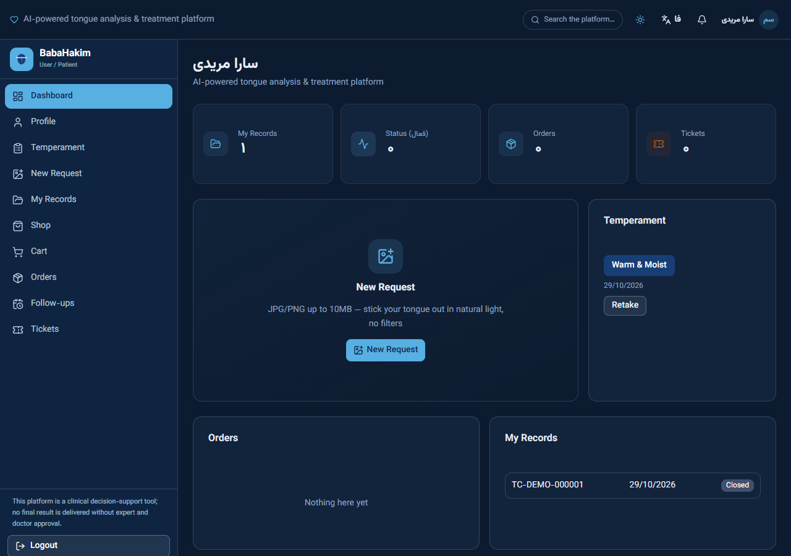
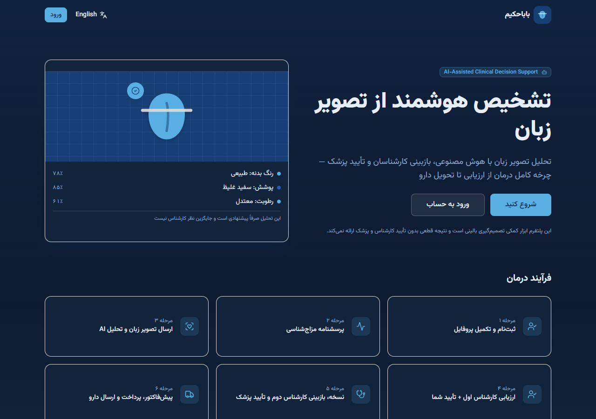
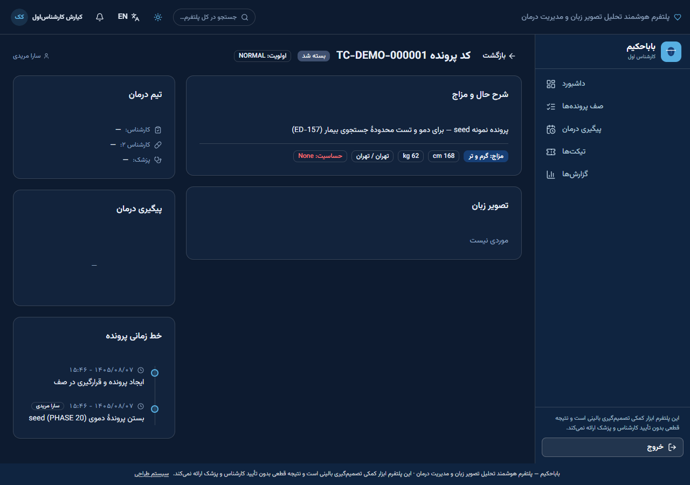

# BabaHakim

**AI-assisted tongue-image health platform for Traditional Persian Medicine (TPM).**
Persian-first (RTL) / English (LTR) bilingual web application with six roles — patient, Expert 1, Expert 2, doctor, operator, administrator — a declarative clinical workflow, an online shop, payments and full audit logging. AI output is advisory only: every assessment and prescription passes human review.

| | |
|---|---|
| Stack | Next.js 16 (App Router, standalone output) · React 19 · TypeScript · Tailwind 4 · shadcn/ui · Prisma 6 + SQLite (WAL) · Bun |
| Quality | 632 automated tests (unit + live-server integration + regression) · 45-scenario pentest · type-check and lint clean |
| Deployment | Multi-stage Docker image (non-root, tini) · nginx TLS reverse proxy · health checks · safe migrations with automatic backup |

> **Medical disclaimer.** BabaHakim supports practitioners; it does not diagnose or prescribe on its own. No drug-interaction data is bundled — that database must be filled from validated sources by qualified staff.



| Landing page (Persian, RTL) | Expert 1 case workspace (Persian, RTL) |
|---|---|
|  |  |

*Captured from a local run on the demo seed data (`bun prisma/seed.ts`) in the dark theme — all accounts and the case shown are synthetic. A light theme is also available.*

## Features

- **Identity** — patients sign in with their Iranian national ID (checksum-validated, stored only as an AES-256-GCM ciphertext plus an HMAC blind index). Family members may share one mobile number. Only an administrator can change a national ID, with a mandatory reason and an audit record. Password recovery binds the one-time code to a single account even on a shared mobile.
- **Patient profile** — age *or* birth date (Jalali date picker; no fabricated dates), searchable province/city, medical history fields.
- **Temperament (mizaj) questionnaire** — optional and resumable; partial answers are saved and clearly labelled incomplete; every response stores the questionnaire and scoring-algorithm version, so editing questions never rewrites past results. Admins manage questions, options (2–10), scores, weights, required flags and categories.
- **Clinical workflow** — a state machine for case → prescription → proforma → payment → shipment → follow-up. Expert 2 can edit a prescription (saved as a new immutable version) or return it to Expert 1 with a reason; a doctor's rejection sends the case back for revision instead of closing it. Every transition writes a timeline event, an audit row and notifications.
- **Prescribing tools** — server-side product search, admin-managed vocabulary for dose / unit / frequency / duration / warnings, guard against dose-without-frequency ambiguity.
- **Case management** — staff case table with patient identity columns, work-queue / date-range / priority filters, server pagination, and archive/restore (archive never deletes data).
- **Support** — patient tickets with categories and priority, staff replies and status changes, notifications.
- **Shop and payments** — cart with server-side pricing, invoices with price snapshots, Zarinpal gateway (server-side verification) and card-to-card receipts with operator approval.
- **Reporting** — report center with CSV (formula-injection safe), XLSX and PDF exports.
- **Security** — RBAC enforced on the server, CSRF double-submit, rate limiting, account lockout, refresh-token rotation with reuse detection, signed short-lived image URLs, strict security headers, production fail-fast when secrets are missing.

## Quick start (development)

```bash
bun install
bun run db:migrate:safe    # creates/updates the SQLite database from migrations
bun prisma/seed.ts         # DEMO data only: 6 demo accounts 09120000001–6 / Pass1234
bun run dev                # http://localhost:3000
```

The demo seed refuses to run when `NODE_ENV=production`.

## Production deployment

See **[docs/en/PRODUCTION-DEPLOYMENT.md](docs/en/PRODUCTION-DEPLOYMENT.md)**. In short:

```bash
cp .env.production.example .env.production   # fill in; secrets from: bash scripts/gen-secrets.sh
docker compose -f docker-compose.prod.yml --env-file .env.production build
docker compose -f docker-compose.prod.yml --env-file .env.production --profile tools run --rm bootstrap   # first admin + reference data
docker compose -f docker-compose.prod.yml --env-file .env.production up -d
```

## Testing

Integration tests drive a live server on port 3000 and **write to that server's database** — always run them against a copy:

```bash
bun run dev:testdb         # dev server bound to the database in .env.test-server (refuses the live one)
bun test src tests         # set DATABASE_URL to the same copy and BH_QA_SERVER_LOG to its log
bash tests/security-pentest.sh
```

## Repository map

| Path | Content |
|---|---|
| `src/app/api/v1` | REST API route handlers (thin controllers) |
| `src/server` | application services, DTOs (Zod), infrastructure (audit, events, cache, jobs, media, reporting) |
| `src/lib/workflow` | declarative state machines + engine + work-queue definitions |
| `src/components/app` | the single-page UI (patient, staff and admin views) |
| `prisma` | schema, versioned migrations, seed |
| `scripts` | safe migrator, secret generator, backup/restore, deploy/rollback, audits |
| `tests` | integration, regression, load and pentest suites |
| `docs` | architecture, security, workflow, QA and deployment documentation (mostly Persian); `docs/en` English |

Delivery reports for the 2026-10 cycle (Persian): `PROJECT_AUDIT.md`, `IMPLEMENTATION_REPORT.md`, `TEST_REPORT.md`, `DATABASE_MIGRATIONS.md`, `DEPLOYMENT_GUIDE.md`, `KNOWN_ISSUES.md`, `USER_GUIDE_FA.md`. English summary: [docs/en/CHANGES-2026-10.md](docs/en/CHANGES-2026-10.md).

## Status

Production-capable core (identity, workflow, shop, tickets, reporting). Not yet implemented: structured medication questionnaire, separate versioned consent forms, multi-photo upload with a photography guide, drug-interaction database, product packs, membership/club and appointment booking, surveys. Real SMS and payment delivery require provider credentials. See `KNOWN_ISSUES.md`.

## License

No license file is included — all rights reserved by the owner unless a license is added.
