# BabaHakim — نمودارهای معماری (Architecture Diagrams)

| فیلد | مقدار |
|---|---|
| نسخه | 1.0.0 |
| تاریخ | 1405/06/14 (2026-09-04) |
| فاز | PHASE 03 — System Architecture |
| سند مادر | `ARCHITECTURE.md` (متن تصمیمات) — این سند فقط نمودارها + توضیح کوتاه هر نمودار |
| ابزار | Mermaid (رندر بومی GitHub/GitLab/VSCode) |

> **یادداشت زبان نمودارها:** برچسب گره‌ها و پیام‌ها در نمودارها به انگلیسی (نام‌های فنی همان اجزای سند مادر) نوشته شده‌اند، چون موتور رندر Mermaid متن را LTR ترسیم می‌کند و متن فارسی RTL در لبه‌ها/برچسب‌ها به‌هم‌ریخته نمایش داده می‌شود. توضیح هر نمودار فارسی است و هر نام انگلیسی دقیقاً معادل جدول‌های `ARCHITECTURE.md` است (قاعده زبان سند: اصطلاحات فنی به انگلیسی).

---

## فهرست

1. [سطح ۱ — System Context (C4)](#1-سطح-۱--system-context-c4)
2. [سطح ۲ — Container (C4)](#2-سطح-۲--container-c4)
3. [مدل وابستگی Tierها (DAG)](#3-مدل-وابستگی-tierها-dag)
4. [Bounded Context Map](#4-bounded-context-map)
5. [کالبد داخلی یک ماژول (Anatomy)](#5-کالبد-داخلی-یک-ماژول-anatomy)
6. [Pipeline تحلیل AI](#6-pipeline-تحلیل-ai)
7. [چرخه عمر بیمار — Sequence سناریوی طلایی (۱۷ مرحله)](#7-چرخه-عمر-بیمار--sequence-سناریوی-طلایی-۱۷-مرحله)
8. [جریان سفارش تا تحویل (با Adapterها)](#8-جریان-سفارش-تا-تحویل-با-adapterها)
9. [جریان رویدادها (Event Flow)](#9-جریان-رویدادها-event-flow)
10. [مالکیت داده — Context و Schema](#10-مالکیت-داده--context-و-schema)
11. [استقرار Dev (docker-compose)](#11-استقرار-dev-docker-compose)
12. [توپولوژی Prod (هدف)](#12-توپولوژی-prod-هدف)
13. [نقشه Extraction آینده](#13-نقشه-extraction-آینده)

---

## 1. سطح ۱ — System Context (C4)

سیستم BabaHakim و بازیگران/سیستم‌های خارجی آن. (معادل PRD §2 — ۶ نقش + ۴ Actor خارجی)

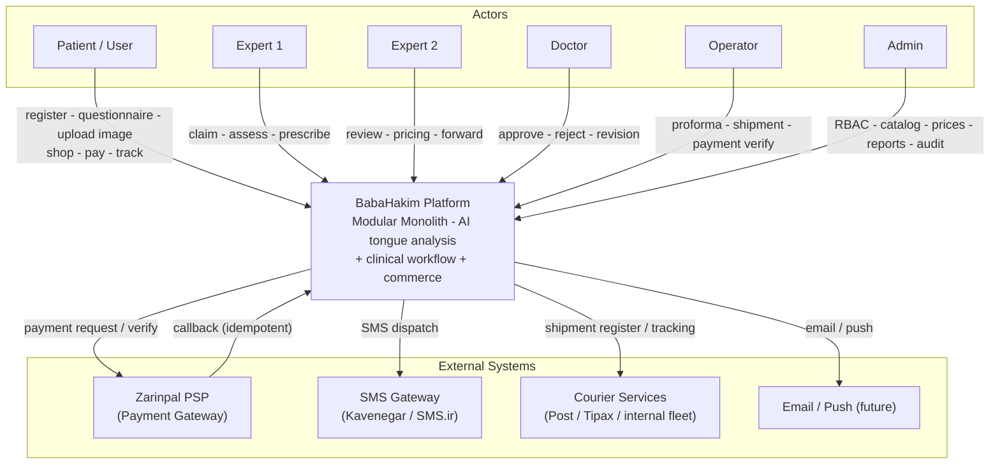

---

## 2. سطح ۲ — Container (C4)

اجزای اجرایی معماری — دقیقاً ۱۱ جزء جدول `ARCHITECTURE.md §3.1`. سبک پیام‌ها: **Sync در-پروسه/HTTP** و **Async از Queue**.

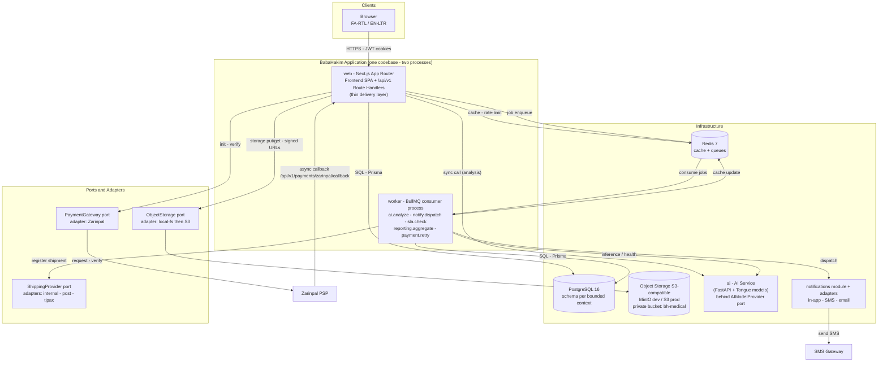

---

## 3. مدل وابستگی Tierها (DAG)

نمودار گراف وابستگی Contextها — قاعده D1 (`ARCHITECTURE.md §5`): پیکان‌ها فقط از بالا به پایین؛ **هیچ مسیر بازگشتی وجود ندارد ⇒ چرخه ریاضیاتاً ناممکن**.

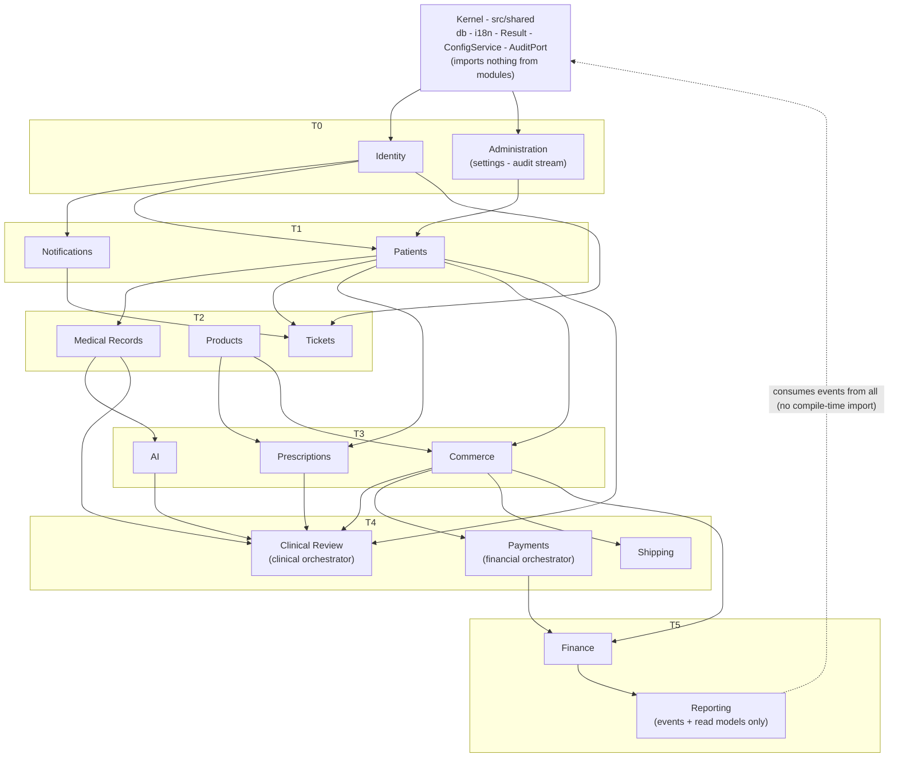

> نکته: خط‌چین `REPORT` یعنی تغذیه **فقط از Event Bus/Read Model** — نه import کد. این تنها رابطه‌ای است که در نمودار وابستگی کامپایل‌زمان دیده نمی‌شود.

---

## 4. Bounded Context Map

نقشه ارتباط دامنه‌ای (Context Map) — نوع رابطه هر Context با بقیه (SO = Sync Facade، EV = Event، SR = Soft Reference):

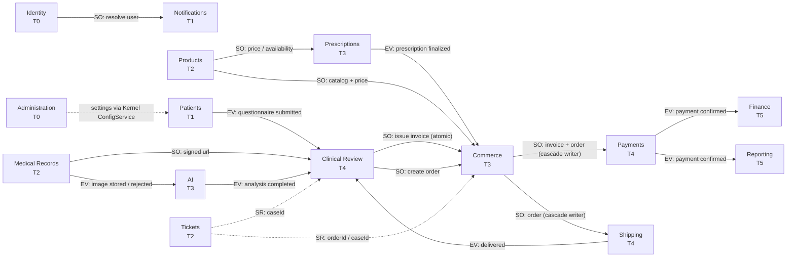

---

## 5. کالبد داخلی یک ماژول (Anatomy)

ساختار استاندارد هر Bounded Context — سطح عمومی فقط `api/` است (قاعده D2):

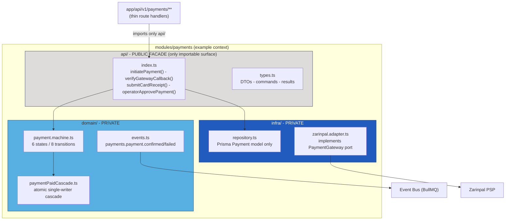

رنگ‌ها طبق Design System BabaHakim: سطح عمومی (خاکستری `#DEDBDB`)، دامنه (آبی روشن `#57AFE2`)، زیرساخت (آبی `#225BBE`).

---

## 6. Pipeline تحلیل AI

مسیر کامل تصویر از آپلود تا بازبینی انسانی (ادغام §4.2 AI و ماشین AI_REVIEW فاز 02):

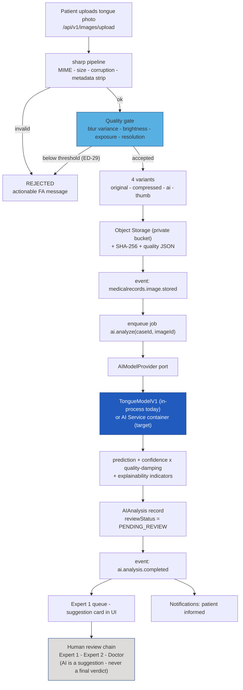

---

## 7. چرخه عمر بیمار — Sequence سناریوی طلایی (۱۷ مرحله)

۱۷ مرحله چرخه عمر بیمار (PRD §9 / USE-CASES §۲) روی اجزای معماری — شماره‌گذاری ۱ تا ۱۷ دقیقاً مطابق فهرست رسمی: Registration, Questionnaire, Image Upload, AI Analysis, Expert 1, Initial Assessment, User Approval, Prescription, Expert 2, Doctor, Order, Invoice, Payment, Shipment, Delivery, Follow-up, Reassessment. برای خوانایی، سه Lane منطقی: بیمار، سیستم (web/worker)، زنجیره انسانی + مالی:

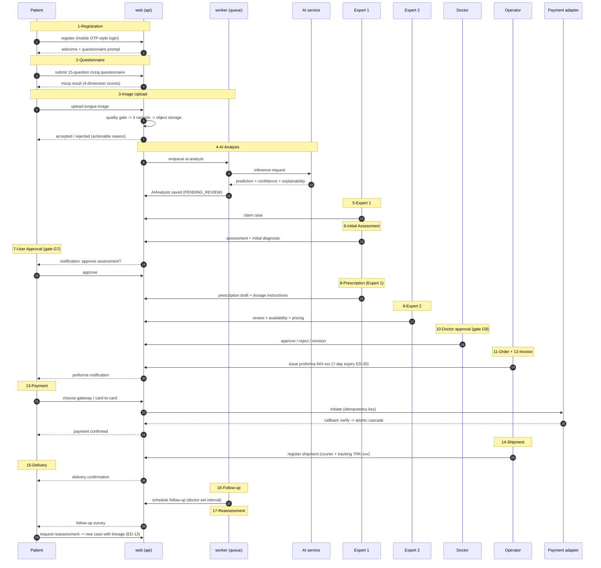

---

## 8. جریان سفارش تا تحویل (با Adapterها)

Cascade مالی-ارسال (ماشین‌های ORDER/PAYMENT/SHIPMENT فاز 02 — ED-33 «نویسنده واحد»):

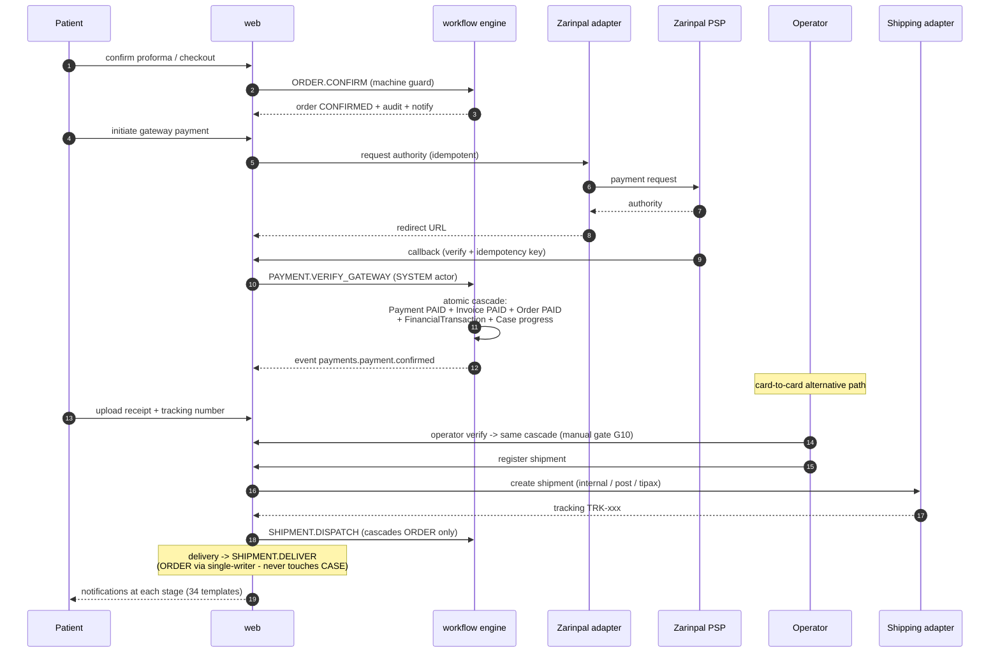

---

## 9. جریان رویدادها (Event Flow)

مسیر Async رویدادهای هسته (کاتالوگ کامل `ARCHITECTURE.md §7.2`). ناشر → Queue → Consumerها:

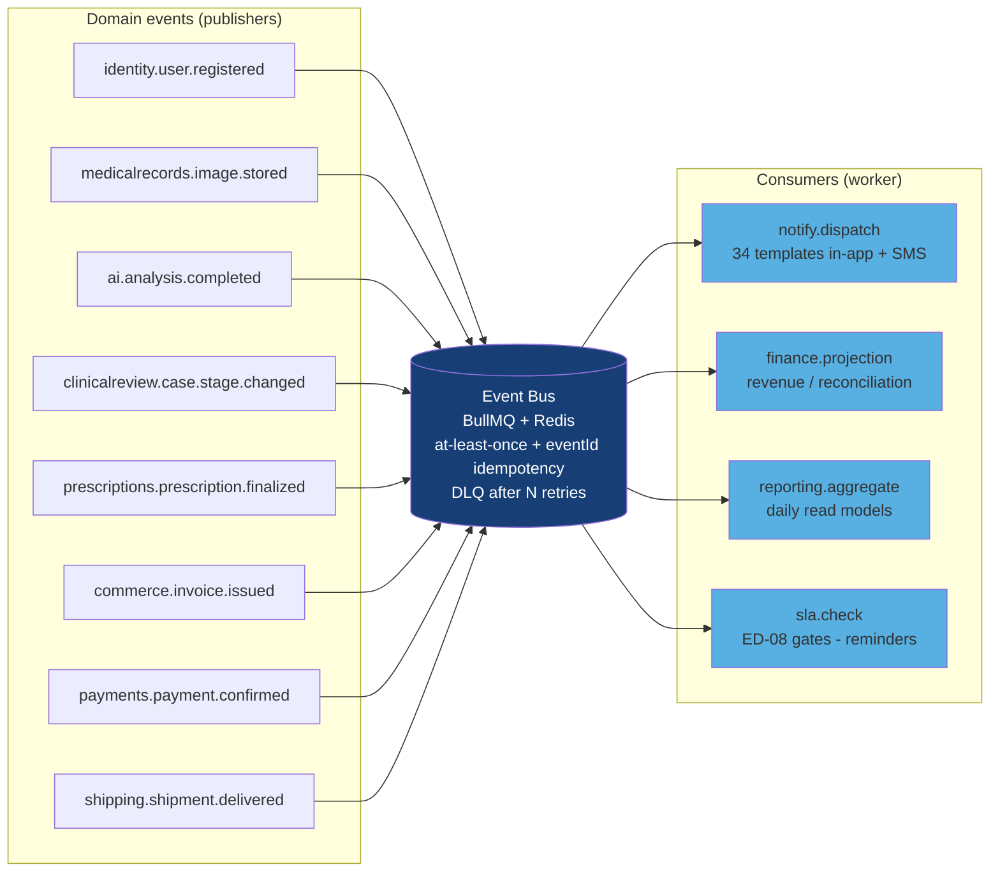

---

## 10. مالکیت داده — Context و Schema

نگاشت ۳۶ مدل Prisma به Contextها و Postgres Schema هدف (تک‌مالکیتی — جدول `ARCHITECTURE.md §4.1`):

```mermaid
flowchart TB
    subgraph db["PostgreSQL - one schema per context (FK across schemas forbidden)"]
        subgraph s_identity["schema: identity"]
            M1["User - Role - Permission<br/>RolePermission - RefreshToken"]
        end
        subgraph s_patients["schema: patients"]
            M2["PatientProfile - Questionnaire<br/>Question - QuestionOption<br/>QuestionnaireResponse - Referral"]
        end
        subgraph s_medrec["schema: medical_records"]
            M3["MedicalImage<br/>4 variants + SHA-256 + quality"]
        end
        subgraph s_ai["schema: ai"]
            M4["AIModel - AIAnalysis"]
        end
        subgraph s_clin["schema: clinical_review"]
            M5["MedicalCase - CaseEvent<br/>Disease - Diagnosis"]
        end
        subgraph s_prod["schema: products"]
            M6["Product - ProductPriceHistory<br/>DiseaseProduct"]
        end
        subgraph s_rx["schema: prescriptions"]
            M7["Prescription - PrescriptionItem"]
        end
        subgraph s_comm["schema: commerce"]
            M8["CartItem - Order - OrderItem - Invoice"]
        end
        subgraph s_pay["schema: payments"]
            M9["Payment"]
        end
        subgraph s_ship["schema: shipping"]
            M10["Shipment"]
        end
        subgraph s_notif["schema: notifications"]
            M11["Notification - SMSLog"]
        end
        subgraph s_tick["schema: tickets"]
            M12["Ticket - TicketMessage"]
        end
        subgraph s_fin["schema: finance"]
            M13["FinancialTransaction"]
        end
        subgraph s_adm["schema: administration"]
            M14["AuditLog (append-only) - SystemSetting"]
        end
        subgraph s_rpt["schema: reporting (read models)"]
            M15["daily_revenue - case_sla - top_products<br/>(projections - not OLTP)"]
        end
    end

    style s_identity fill:#DEDBDB,stroke:#173F76
    style s_clin fill:#57AFE2,stroke:#173F76
    style s_rpt fill:#DEDBDB,stroke:#225BBE,stroke-dasharray: 5 5
    style db fill:#FFFFFF,stroke:#173F76
```

> ارجاع بین‌Schema فقط Soft Reference (ID) — مثل `Ticket.orderId`. در SQLite فعلی همین تفکیک با تست معماری نگه داشته می‌شود.

---

## 11. استقرار Dev (docker-compose)

توپولوژی استقرار توسعه (قید C4 — هم VSCode هم Docker):

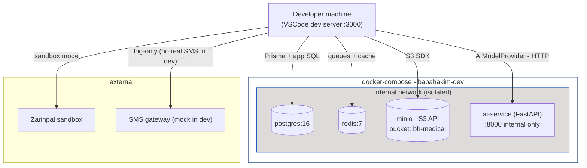

---

## 12. توپولوژی Prod (هدف)

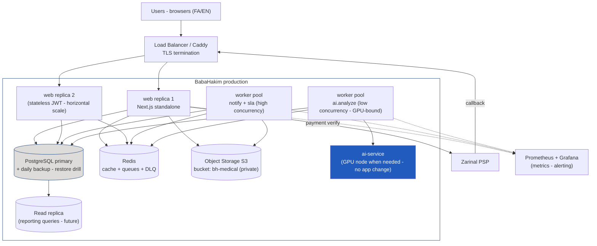

---

## 13. نقشه Extraction آینده

مسیر معیارمحور شکستن Monolith (فقط پس از برآورده‌شدن معیارهای `ARCHITECTURE.md §2.3`) — استراتژی Strangler:

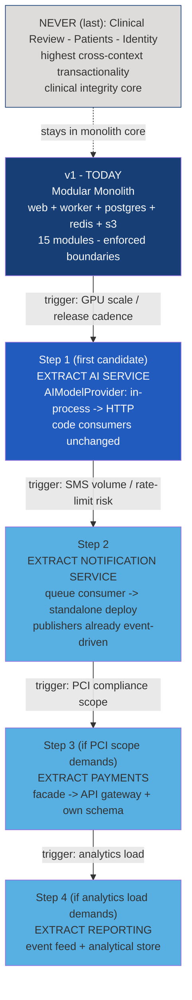

---

## نکات رندر

- همه نمودارها با Mermaid v10+ سازگارند (GitHub / VSCode Mermaid Preview / GitLab).
- رنگ‌های به‌کاررفده از Design System رسمی BabaHakim هستند: `#173F76`، `#225BBE`، `#57AFE2`، `#DEDBDB` (سند `BRANDING.md`).
- در صورت تغییر معماری، این سند به‌همراه `ARCHITECTURE.md` و ADR مربوطه در یک Commit به‌روزرسانی می‌شوند (قاعده ۱۱ منشور).
