# BabaHakim — ERD | نمودار ارتباط موجودیت‌ها (PHASE 04)

> منبع تولید: `database/models/` (SQLAlchemy Metadata) — اسکریپت: `database/scripts/generate_er_diagrams.py`. نمادها: `PK` کلید اصلی، `FK` کلید خارجی واقعی (درون-Context)، `UK` یکتا. روابط بین-Context طبق ADR-0004/D4 **Soft Reference** هستند (بدون FK فیزیکی).

## ۱) نمای کلان Contextها و ارجاع‌های بین-Context (D4)

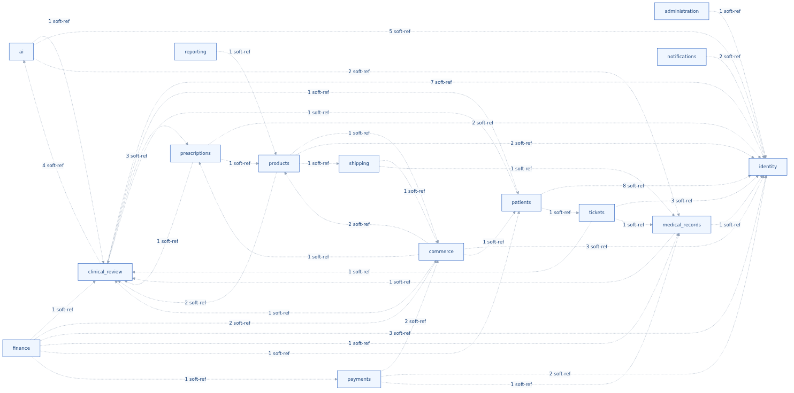

هر یال = تعداد ستون‌های Soft Reference از Context مبدأ به Context مقصد (بدون FK فیزیکی — اعتبارسنجی در لایه Facade + تست یکپارچگی).

## ۲) ERD مسیر طلایی (موجودیت‌های هسته، بین-Context)

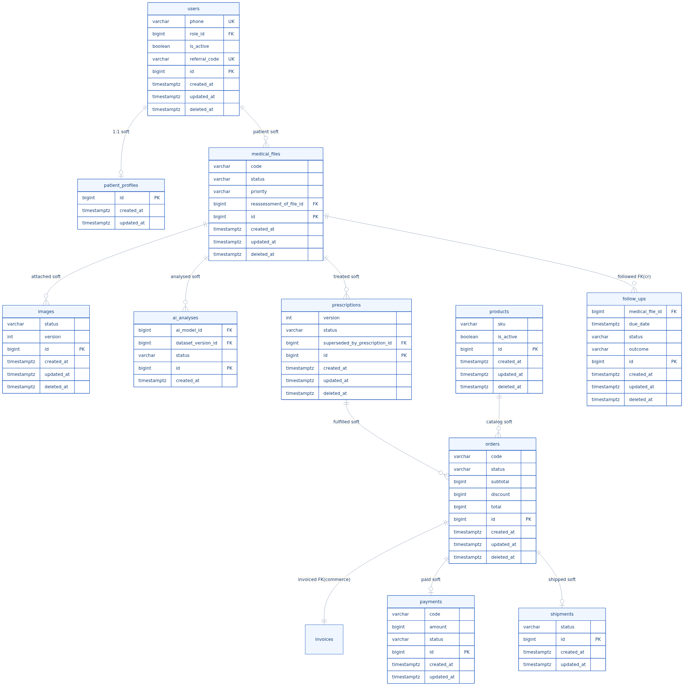

مسیر ۱۷-مرحله‌ای بیمار روی هسته داده: `users → medical_files → ai_analyses → prescriptions → orders → invoices → payments → shipments → follow_ups`. برچسب «soft» = مرجع نرم بین-Context.

## ۳) ERD به‌ازای هر Bounded Context (روابط FK واقعی)

### Context «administration» — مدیریت و حسابرسی (1 جدول)

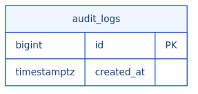

### Context «ai» — هوش مصنوعی (5 جدول)

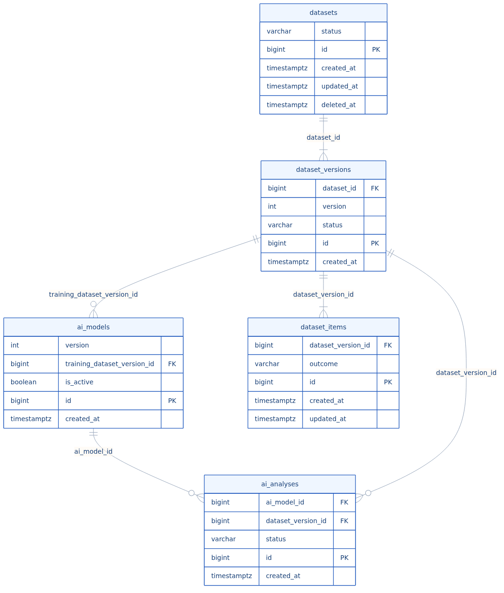

### Context «clinical_review» — بازبینی بالینی (7 جدول)

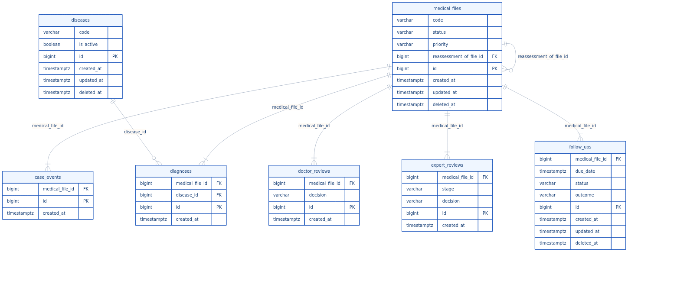

### Context «commerce» — فروش و سفارش (5 جدول)

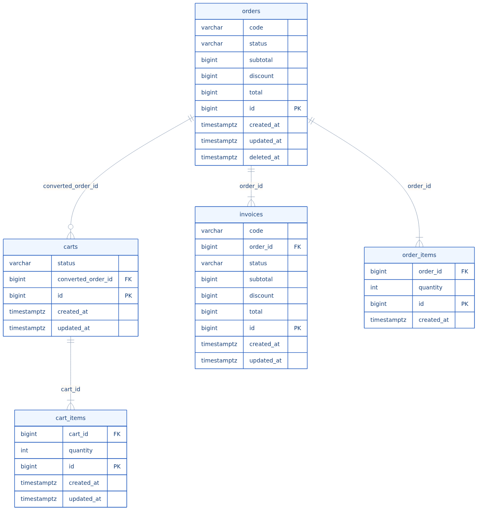

### Context «finance» — مالی (2 جدول)

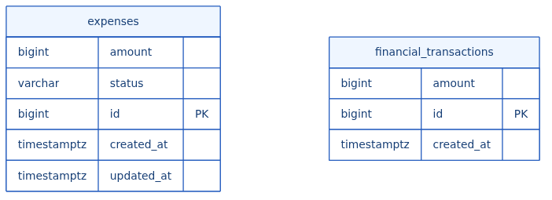

### Context «identity» — هویت و دسترسی (5 جدول)

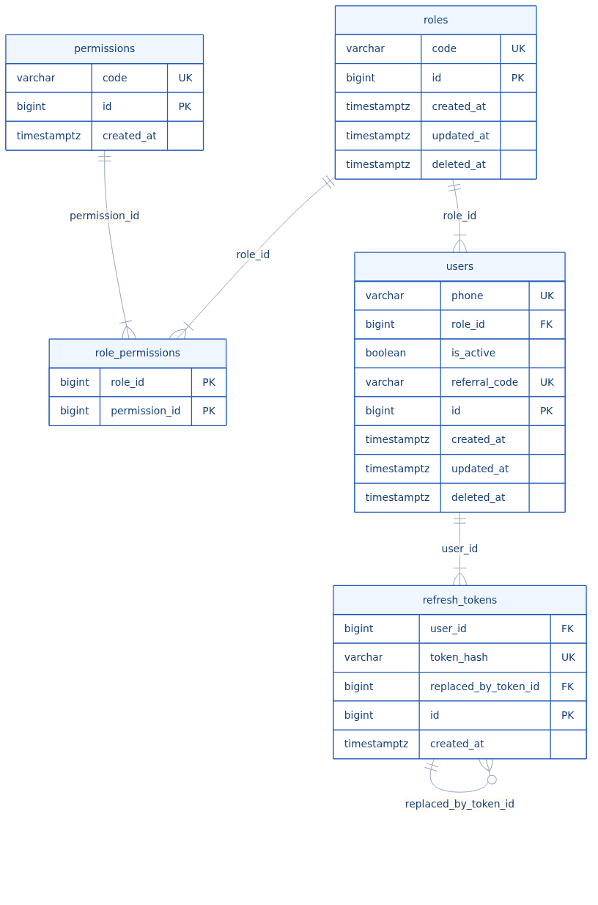

### Context «medical_records» — پرونده پزشکی (1 جدول)

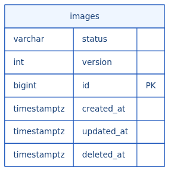

### Context «notifications» — اعلان‌ها (2 جدول)

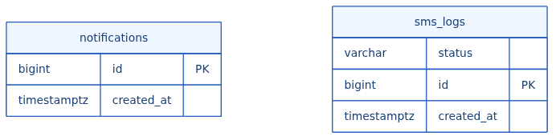

### Context «patients» — بیمار و پرسشنامه (9 جدول)

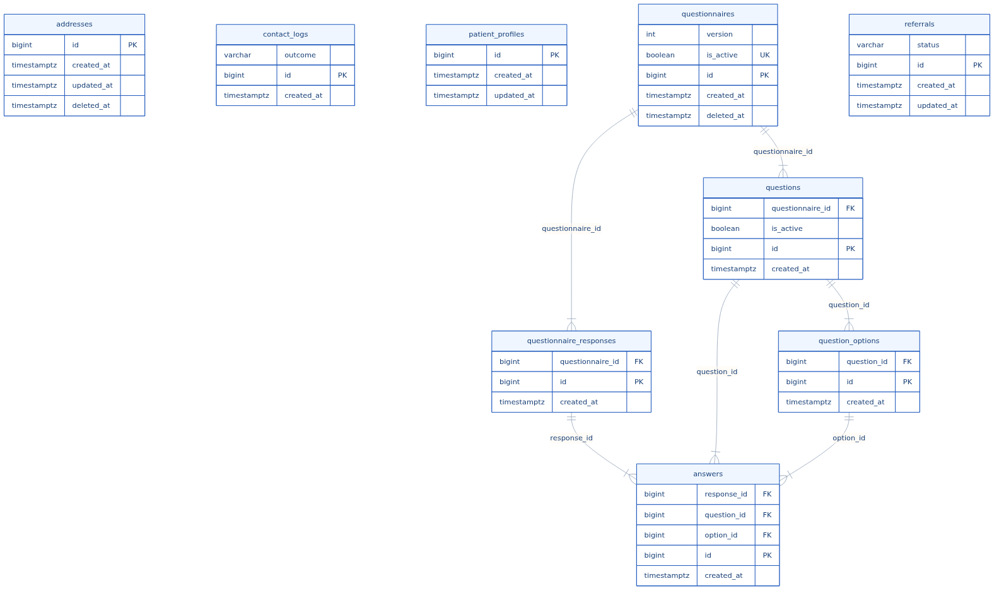

### Context «payments» — پرداخت (1 جدول)

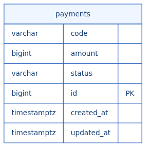

### Context «prescriptions» — نسخه‌ها (2 جدول)

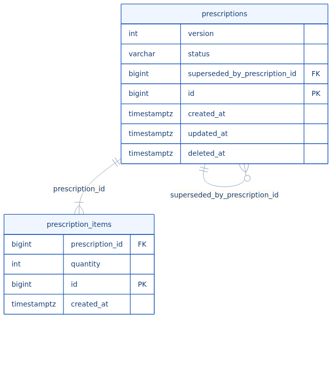

### Context «products» — محصولات و انبار (5 جدول)

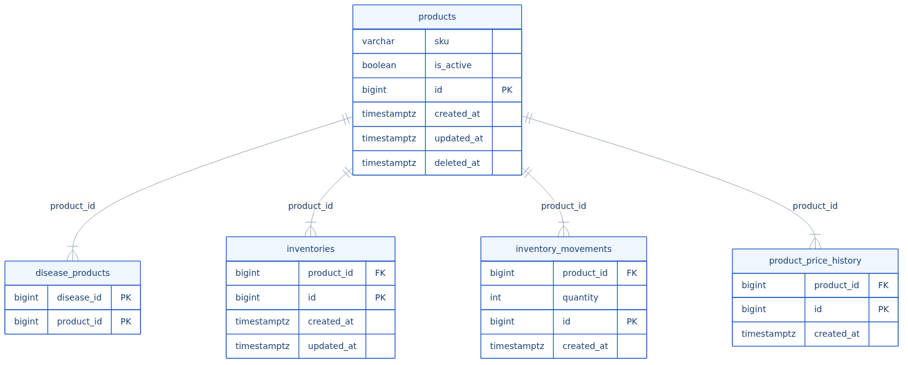

### Context «reporting» — گزارش‌ها (Read Model) (1 جدول)

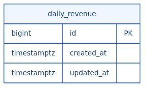

### Context «shipping» — ارسال (1 جدول)

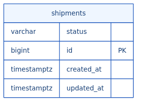

### Context «tickets» — پشتیبانی (2 جدول)

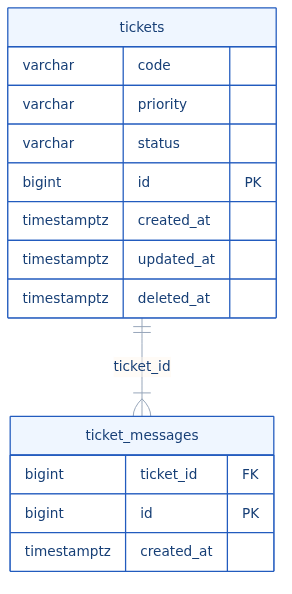
