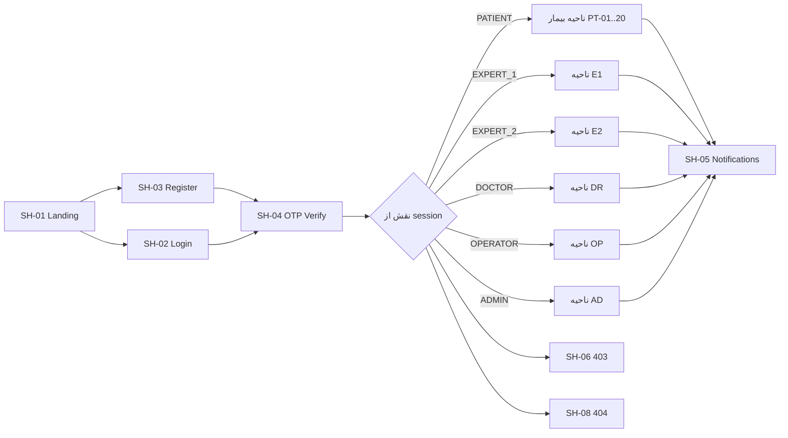
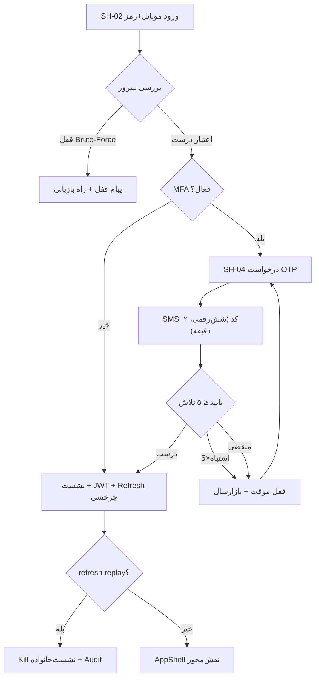
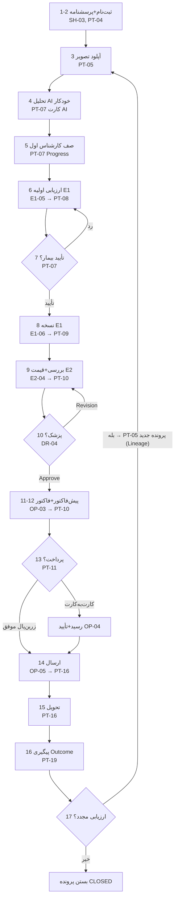
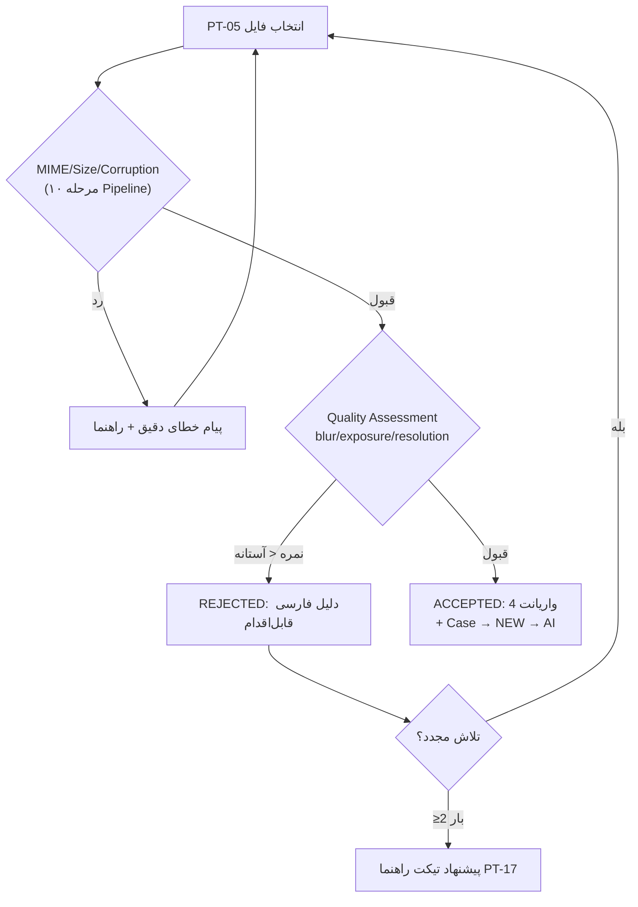
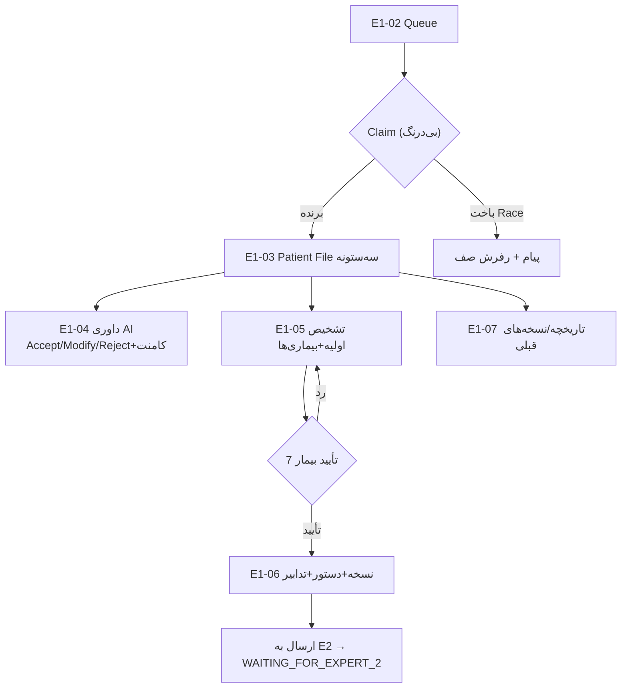
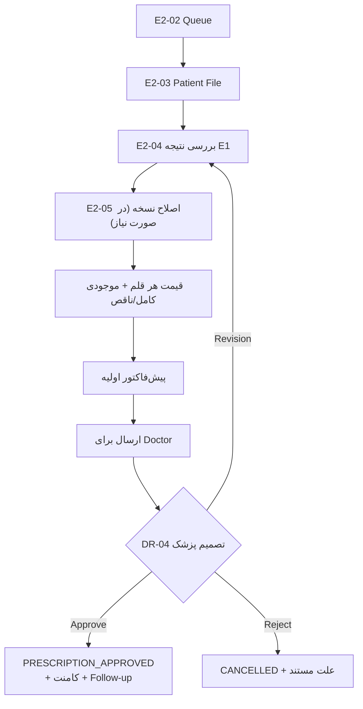
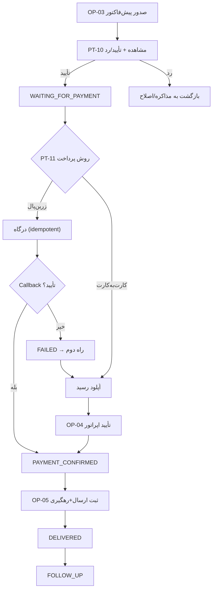
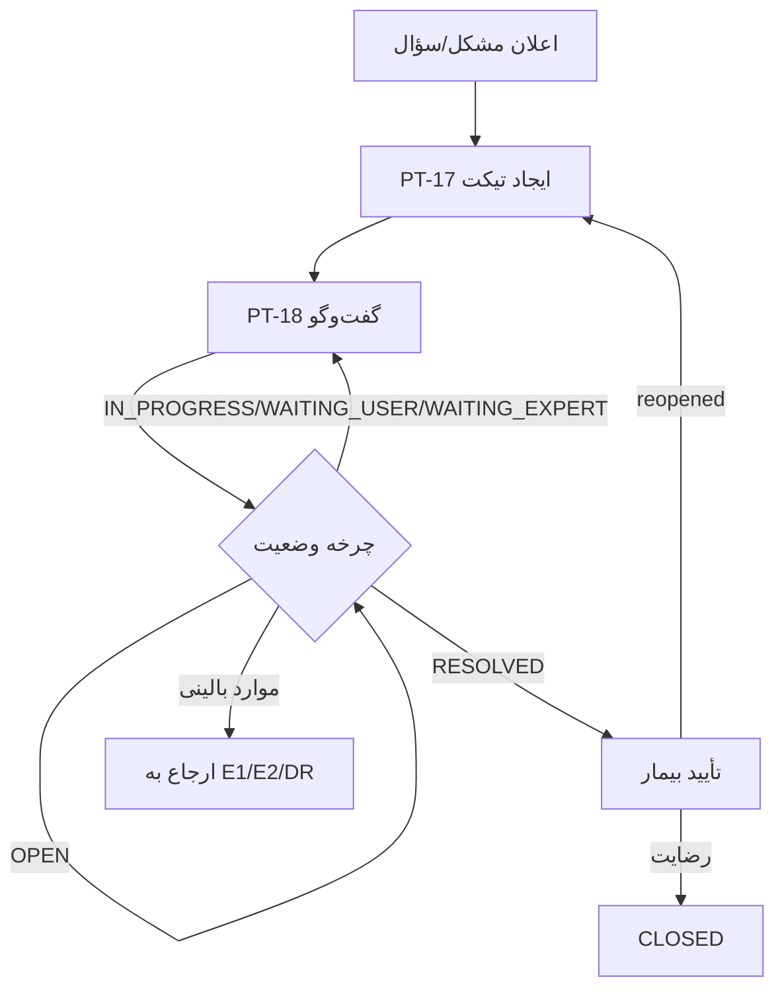
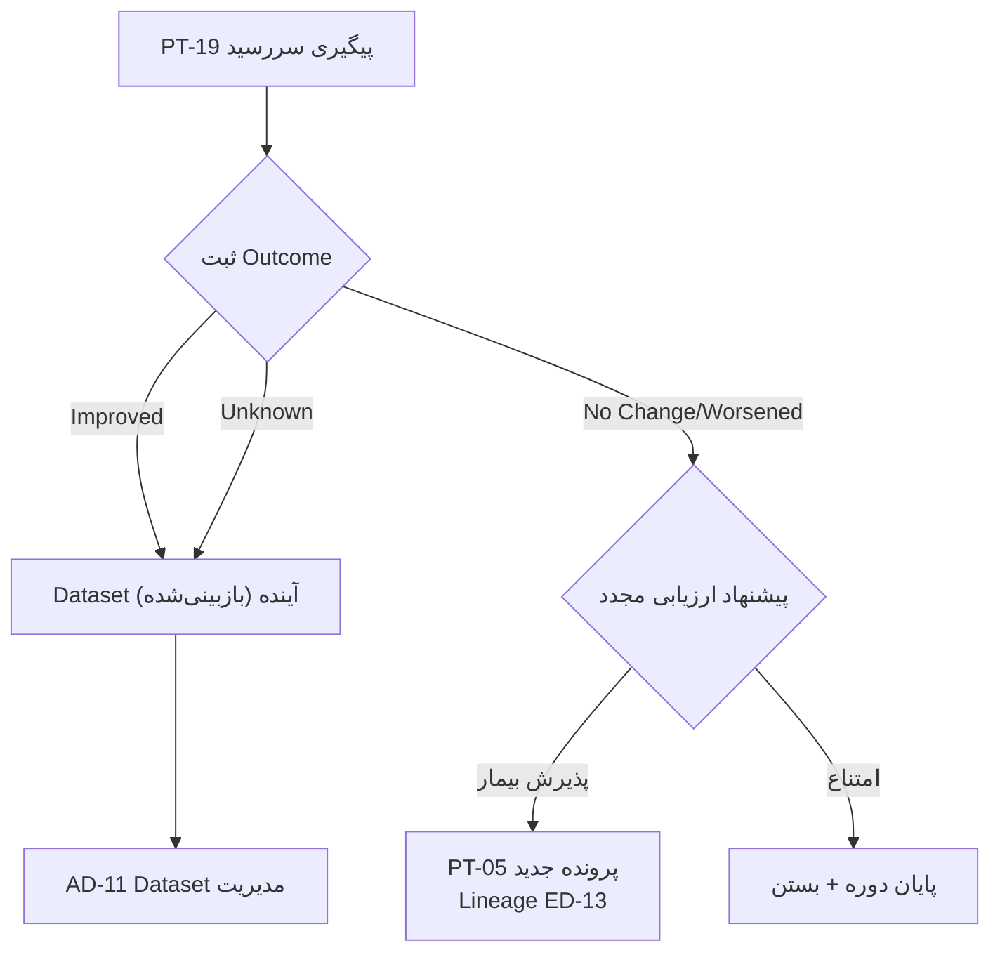

# BabaHakim — معماری تجربه کاربری (UX Architecture)

| فیلد | مقدار |
|---|---|
| نسخه | 1.0.0 |
| تاریخ | ۱۴۰۵/۰۶/۱۴ (2026-09-04) |
| فاز | PHASE 06 — UX Architecture |
| فرمان محصول | طراحی UX Architecture برای هر ۶ نقش قبل از ساخت UI نهایی: User Journey + Sitemap + Screen Inventory + Flow Diagram + مشخصات ۹ فیلدی هر صفحه |
| ورودی‌ها | Master Prompt §4 (اسناد ۷ و ۸) · §5 نقش‌ها · §8 تصویر زبان · §17 Workflow · §18-§23 صف/کارشناسان/اپراتور/دکتر/پنل کاربر · §24-§31 فروشگاه/سفارش/پرداخت/تیکت/اعلان · §33 Follow-up · §37-§38 داشبورد/گزارش · §40 UI/UX · §41 Timeline · §69-§70 i18n/A11y · §80-§82 UX کارشناسان و داوری AI |
| اسناد مبنای دیگر | `docs/PRD.md` (شخصیت‌ها/FR) · `docs/WORKFLOW.md` (۲۱ وضعیت پرونده) · `docs/BRANDING.md` (Design System) · `src/lib/constants.ts` (۳۱ Permission) |
| خروجی‌های همزمان | `docs/SCREEN-MAP.md` — فهرست کامل ۷۳ صفحه با ۹ فیلد اجباری |
| مخاطب | تیم Frontend · QA · Product Owner |

---

## فهرست

1. [هدف، دامنه و روش](#1-هدف-دامنه-و-روش)
2. [اصول حاکم بر UX (۱۰ اصل)](#2-اصول-حاکم-بر-ux-۱۰-اصل)
3. [پرسوناها و نقش‌ها](#3-پرسوناها-و-نقش‌ها)
4. [User Journey ها (۶ نقش)](#4-user-journey-ها-۶-نقش)
5. [Sitemap و مدل مسیرها](#5-sitemap-و-مدل-مسیرها)
6. [نمودارهای جریان (Flow Diagrams)](#6-نمودارهای-جریان-flow-diagrams)
7. [سیستم حالت‌های صفحه (State System)](#7-سیستم-حالت‌های-صفحه-state-system)
8. [ناوبری و Layout](#8-ناوبری-و-layout)
9. [دسترس‌پذیری، i18n و RTL](#9-دسترس‌پذیری-i18n-و-rtl)
10. [متدولوژی Screen Inventory](#10-متدولوژی-screen-inventory)
11. [ردیابی (Traceability)](#11-ردیابی-traceability)
12. [تصمیمات مهندسی فاز ۶ (ED-71..ED-80)](#12-تصمیمات-مهندسی-فاز-۶-ed-71ed-80)

---

## 1. هدف، دامنه و روش

این سند **معماری تجربه کاربری** پلتفرم باباحکیم است و پیش‌نیاز ساخت UI نهایی (فاز بعدی) است. هدف آن این است که پیش از نوشتن حتی یک کامپوننت جدید، همه تصمیم‌های ساختاری UX گرفته شده، مستند شده و قابل ردیابی به Master Prompt باشند. تجربه‌ی کاربر در این پلتفرم پیچیدگی خاصی دارد: بیمار در یک چرخه ۱۷ مرحله‌ای حرکت می‌کند که در نقاط مختلفی باید **منتظر انسان‌ها** بماند (کارشناس اول، خودِ بیمار، کارشناس دوم، پزشک، اپراتور)؛ بنابراین «انتظار شفاف» هسته‌ی UX بیمار است و «سرعت و تمرکز» هسته‌ی UX کارشناسان.

دامنه این سند: (۱) User Journey برای هر ۶ نقش Admin / Expert 1 / Operator / Expert 2 / Doctor / Patient، (۲) Sitemap کامل، (۳) Flow Diagram های مسیرهای اصلی و استثنا، (۴) سیستم حالت‌های صفحه (Empty / Loading / Error / Success)، (۵) مدل ناوبری و Layout، و (۶) ارجاع به `SCREEN-MAP.md` که **Screen Inventory** کامل با ۹ فیلد اجباری (هدف · کاربر · اطلاعات · Actions · Permissions · Empty · Loading · Error · Success) برای تمام ۷۳ صفحه را در بر دارد.

خارج از دامنه: طراحی بصری تفصیلی (رنگ/فونت/کامپوننت — مرجع: `BRANDING.md`)، قرارداد API (فازهای ۰۱/۰۳)، و پیاده‌سازی. روش کار: استخراج نیازمندی‌های UX از Master Prompt و اسناد فاز ۰۱، مطابقت با وضعیت واقعی v1 (SPA فعلی)، و تعریف «صفحه هدف» (v2) در جایی که v1 فقط نمای درهم‌یافته دارد. هر صفحه یک شناسه پایدار `SC-*` می‌گیرد که در فاز UI rebuild مبنای Issue/Test/Trace خواهد بود.

---

## 2. اصول حاکم بر UX (۱۰ اصل)

این اصول در همه صفحات بدون استثنا اعمال می‌شوند و ملاک QA بصری و Review فاز UI هستند:

| # | اصل | تعریف اجرایی | منبع |
|---|---|---|---|
| UX-01 | **AI پیشنهاد می‌دهد، انسان تصمیم می‌گیرد** | هیچ صفحه‌ای خروجی AI را «تشخیص نهایی» نمایش نمی‌دهد؛ کارت AI همیشه برچسب «پیشنهاد — نیازمند داوری انسانی» + Confidence + Explainability دارد و زنجیره تأیید (کارشناس/پزشک) جداگانه رندر می‌شود | §2 · §81 · PRD اصل ۱ |
| UX-02 | **وضعیت اول، جزئیات بعد** | هر صفحه‌ی پرونده‌محور، Status جاری Case را قبل از داده‌ها نمایش می‌دهد (StatusBadge طبق BRANDING §5) تا کاربر بداند «کجای چرخه» است | §40 · §41 |
| UX-03 | **انتظار شفاف برای بیمار** | هر گام انتظار (کارشناس/پزشک/پرداخت/ارسال) باید بگوید «چه کسی، چه کاری، کِی» — Progress Track + گام بعدی + اعلان | §31 · §41 |
| UX-04 | **سرعت برای کارشناس** | صف کارشناس باید «بسیار سریع» باشد: جدول مجازی، Claim بی‌درنگ، حداقل کلیک تا اقدام، بدون اعلان مزاحم درون-فرم | §18 · §80 |
| UX-05 | **سه‌ستونه + Timeline** | صفحه پرونده کارشناسی: ستون «خلاصه بیمار» · ستون «تصاویر + AI» · ستون «تشخیص/نسخه/اقدامات» و در پایین Timeline/History/Tickets (در RTL آینه‌ای) | §80 · §41 |
| UX-06 | **هر صفحه ۴ حالت دارد** | هیچ صفحه‌ی داده‌محور بدون Empty/Loading/Error/Success طراحی نمی‌شود؛ الگوهای SP-1..SP-8 بخش §۷ اجباری‌اند | §40 (State colors) |
| UX-07 | **UI تابع دسترسی واقعی** | ناوبری/دکمه‌ها فقط بر اساس Permissionهای سروری رندر می‌شوند؛ UI هرگز «منبع مجاز» نیست؛ اکشن بدون دسترسی = مخفی (نه فقط غیرفعال) + پاسخ 403 سرور | §5 · SECURITY.md |
| UX-08 | **دوزبانه از ابتدا، RTL-first** | فارسی RTL + تقویم شمسی پیش‌فرض؛ سوییچ زنده EN/LTR بدون Reload؛ هیچ متن Hardcode — همه از لایه i18n | §39 · §69 · PRD I18N |
| UX-09 | **دسترس‌پذیری حداقلی تضمینی** | Keyboard Navigation کامل، Focus ring برند (#225BBE)، ARIA روی کنترل‌ها، کنتراست AA، Target لمسی ≥ 44px | §70 |
| UX-10 | **انطباق برند بدون استثنا** | فقط توکن‌های `--bh-*`؛ رنگ‌های معنایی (سبز/کهربایی/قرمز) فقط برای معنا؛ دارک‌مود سرمه‌ای مشتق | BRANDING.md §2-§5 |

---

## 3. پرسوناها و نقش‌ها

شش نقش سیستم (constants.ts `ROLES`) به‌صورت پرسونای عملیاتی زیر مدل می‌شوند. «نیاز کلیدی» عیناً همان چیزی است که Sitemap و Screen Inventory باید پاسخ دهند:

| نقش | پرسونا | هدف اصلی | نیاز کلیدی در UI | نقطه درد اصلی | KPI موفقیت UX |
|---|---|---|---|---|---|
| **PATIENT** | سارا، ۳۴ ساله، کاربر موبایل، آشنایی کم با فناوری | دریافت تشخیص مکمل و دارو در منزل، بدون مراجعه | بداند «الان کجای مسیر است» و «بعدش چه می‌شود»؛ آپلود ساده با راهنمای کیفیت | سردرگمی در انتظار‌های طولانی؛ کیفیت تصویر رد می‌شود و نمی‌داند چطور | نرخ تکمیل چرخه ≥ ۸۰٪ · آپلود موفق ≤ ۲ تلاش · تیکت کم سؤالِ «وضعیت چیست؟» |
| **EXPERT_1** | کیارش، کارشناس بالینی تمام‌روز | رسیدگی به حداکثر پرونده در روز با کیفیت ثابت | صف سریع، همه داده بیمار در یک صفحه، فرم نسخه سریع | جابه‌جایی بین صفحه‌ها؛ تصاویر بی‌کیفیت؛ گم‌شدن پرونده‌های بی‌اقدام | پرونده/روز · زمان رسیدگی median · صفر پرونده Overdue |
| **EXPERT_2** | ثریا، کارشناس ارشد و مسئول قیمت‌گذاری | کنترل کیفیت نسخه + قیمت‌گذاری + هماهنگی با پزشک | دید مقایسه‌ای نسخه اولیه/نهایی؛ قیمت‌گذاری اقلام با موجودی | هماهنگی دکتر/فاکتور؛ اقلام ناموجود دیر مشخص می‌شوند | زمان تا ارسال برای دکتر · دقت پیش‌فاکتور (صفر اصلاح) |
| **DOCTOR** | دکتر نیک‌پور، پزشک ناظر، زمان محدود | تصمیم نهایی سریع و مستند روی هر نسخه | پرونده فشرده + نسخه + پیشنهاد کارشناسان + AI در یک نگاه | آشفتگی اطلاعات؛ نبود تاریخچه تصمیم‌ها | زمان تصمیم median · صفر نسخه بدون کامنت |
| **OPERATOR** | پویا، اپراتور عملیات روزانه | روان‌سازی مالی/ارسال/پیگیری بدون سردرگمی | کارهای امروزِ من: پیش‌فاکتور، تأیید پرداخت، ارسال، تیکت | پراکندگی کارها در صفحات متعدت | صفر پرداخت تأییدنشده > ۲۴h · DELIVERED به‌موقع |
| **ADMIN** | رعیا، مدیر سیستم و محصول | حاکمیت داده، کاربران، قیمت‌ها و پایش سلامت کسب‌وکار | داشبورد KPI + ابزارهای CRUD امن + Audit | تغییرهای خطرناک بدون ردیابی؛ قیمت‌های قدیمی گم می‌شوند | ۱۰۰٪ عملیات حساس Audited · صدور گزارش < ۳۰ ثانیه |

> نکته مدل دسترسی: نقش PATIENT **فقط مالکیت‌محور** است (داده‌ی خودش) و عضوی از کاتالوگ Permission نیست (ED-77)؛ پنج نقش دیگر Permission-Based طبق ماتریس ۳۱×۶ در `BUSINESS-RULES.md` §RBAC.

---

## 4. User Journey ها (۶ نقش)

هر Journey: جدول گام‌ها (صفحه + اقدام + نتیجه سیستم + وضعیت Case)، سپس «لحظه‌های حساس» و «ریسک‌های دورافتادگی + بازیابی». وضعیت‌ها از ۲۱ وضعیت رسمی Case (`WORKFLOW.md`) و شماره مراحل از چرخه ۱۷ مرحله‌ای رسمی (Registration → Reassessment) است.

### UJ-1 — Patient (چرخه کامل ۱۷ مرحله‌ای)

مسیر طلایی بیمار؛ ستون «گیت» همان دروازه‌های تأیید G1..G10 (PRD §فرهنگ اعلان/تأیید) است:

| # | مرحله چرخه | صفحه | اقدام کاربر | نتیجه سیستم / اعلان | وضعیت Case | گیت |
|---|---|---|---|---|---|---|
| 1 | Registration | SH-03 → SH-04 | ثبت‌نام با موبایل + کد OTP | حساب + رضایت‌ها (TERMS/PRIVACY/MEDICAL_IMAGE_AI) ثبت؛ خوش‌آمد SMS | — (بدون Case) | G0 |
| 2 | Questionnaire | PT-04 | پاسخ پرسشنامه مزاج (ویزارد) | نتیجه مزاج (۴ بُعد) در پرونده ذخیره؛ نسخه پرسشنامه ثبت | — | |
| 3 | Image Upload | PT-05 | آپلود تصویر زبان + تأیید کیفیت | Pipeline ۱۰ مرحله‌ای؛ QGATE → ACCEPTED → ۴ واریانت + Case ساخته می‌شود | NEW | |
| 4 | AI Analysis | PT-07 (کارت AI) | مشاهده خودکار | تحلیل TongueModelV1 با Confidence + Explainability + دیسکلیمر UX-01 | WAITING_FOR_EXPERT_1 | |
| 5 | Expert 1 | PT-07 (Progress) | انتظار + اعلان «کارشناس پرونده را گرفت» | Claim توسط E1 → اعلان برای بیمار | EXPERT_1_REVIEW | |
| 6 | Initial Assessment | PT-07 / PT-08 | مشاهده ارزیابی اولیه | تشخیص اولیه + بیماری‌ها + کامنت کارشناس ثبت | WAITING_FOR_USER_APPROVAL | **G1: تأیید بیمار** |
| 7 | User Approval | PT-07 | تأیید/رد ادامه درمان | تأیید → درخواست نسخه؛ رد → بازگشت به E1 | WAITING_FOR_EXPERT_1_PRESCRIPTION | |
| 8 | Prescription | PT-09 | مشاهده نسخه + دستور مصرف | نسخه E1 نهایی → صف E2 | WAITING_FOR_EXPERT_2 | |
| 9 | Expert 2 | PT-07 (Progress) | انتظار | بررسی/اصلاح + قیمت‌گذاری + موجودی → ارسال برای پزشک | WAITING_FOR_DOCTOR | **G2: تأیید پزشک** |
| 10 | Doctor | PT-07 | انتظار | Approve/Reject/Revision + کامنت + Follow-up پیشنهادی | PRESCRIPTION_APPROVED / REVISION_REQUESTED | |
| 11 | Order | PT-10 | مشاهده پیش‌فاکتور | پروفرمای اپراتور + اقلام + قیمت | PROFORMA_CREATED | **G3: تأیید پیش‌فاکتور** |
| 12 | Invoice | PT-10 | تأیید پیش‌فاکتور | فاکتور نهایی صادر | WAITING_FOR_PAYMENT | |
| 13 | Payment | PT-11 | پرداخت آنلاین یا کارت‌به‌کارت + رسید | زرین‌پال (idempotent) یا تأیید دستی اپراتور | PAYMENT_CONFIRMED | **G4: پرداخت** |
| 14 | Shipment | PT-16 | مشاهده پیگیری | ثبت ارسال + کد رهگیری | SHIPPED | |
| 15 | Delivery | PT-16 | تأیید دریافت | تحویل + اعلان شروع دوره درمان | DELIVERED → FOLLOW_UP | |
| 16 | Follow-up | PT-19 | پاسخ پیگیری (Outcome) | Improved/No Change/Worsened ثبت → Dataset آینده | FOLLOW_UP | |
| 17 | Reassessment | PT-05 | درخواست ارزیابی مجدد | Case جدید با Lineage (ED-13) | REFERRED_AGAIN → CLOSED(قدیمی) | |

**لحظه‌های حساس:** گام ۳ (رد کیفیت تصویر — باید پیام «قابل‌اقدام» بدهد: چرا رد شد + چطور بهتر شود + تلاش مجدد بدون از دست دادن پرسشنامه)، گام ۶ (تأیید بیمار — واضح‌ترین CTA در کل محصول)، گام ۱۳ (پرداخت — بدون دکمه دوبار-کلیک/Spin قفل)، گام ۱۷ (بازگشت — خستگی نباید مانع چرخه دوم شود: «پرونده جدید با یک کلیک»).

**ریسک‌ها و بازیابی:** رد تصویر ≥ ۲ بار → پیشنهاد تیکت/راهنمای تصویربرداری (PT-17 لینک مستقیم)؛ معطلی > SLA در گام ۵/۹/۱۰ → یادآور خودکار + نمایش «متأخر» به اپراتور (OP-02)؛ پرداخت ناموفق → راه دوم کارت‌به‌کارت در همان صفحه (PT-11)؛ منقضی‌شدن نشست در وسط فرم → حفظ Form State + ورود مجدد بدون از دست دادن داده.

### UJ-2 — Expert 1 (دایره روزانه کاری)

| گام | صفحه | اقدام | نتیجه |
|---|---|---|---|
| 1 | E1-01 | ورود و دیدن آمار روز/هفته + SLA | صف‌بندی ذهنی روز |
| 2 | E1-02 | فیلتر «در انتظار» / «متأخر» → Claim | پرونده قفل مالکیت روی E1 → Case به EXPERT_1_REVIEW + اعلان بیمار |
| 3 | E1-03 | مطالعه پرونده (خلاصه/شرح‌حال/مزاج) | — |
| 4 | E1-04 | داوری AI: Accept / Modify / Reject + کامنت | reviewStatus ثبت → ماشین AI_REVIEW |
| 5 | E1-05 | تشخیص اولیه + بیماری‌ها + کامنت | SUBMIT_ASSESSMENT → WAITING_FOR_USER_APPROVAL |
| 6 | E1-06 | پس از تأیید بیمار: نسخه + دستور + تدابیر غذایی + مدت ارجاع | SUBMIT_PRESCRIPTION → WAITING_FOR_EXPERT_2 |
| 7 | E1-07 / E1-08 | مرور تاریخچه/گزارش عملکرد شخصی | بهبود فرآیند شخصی |

**ریسک‌ها:** Claim تازه‌نفسِ پرونده‌ی دیگری (race) → پیام «پرونده توسط کارشناس دیگری گرفته شد» + رفرش؛ تصویر ردشده در گذشته → پرچم و مسیر «درخواست تصویر مجدد از بیمار» (تیکت).

### UJ-3 — Expert 2 (کنترل کیفیت + قیمت‌گذاری)

| گام | صفحه | اقدام | نتیجه |
|---|---|---|---|
| 1 | E2-01 | داشبورد: منتظران من + موارد ارسالی به پزشک | — |
| 2 | E2-02 → E2-03 | Claim از صف E2 | Case به WAITING_FOR_DOCTOR مسیر پیش می‌رود |
| 3 | E2-04 | بررسی نتیجه E1 + اصلاح نسخه (در صورت نیاز) + قیمت هر قلم + موجودی کامل/ناقص | EXPERT2_REVIEW + اقلام قیمت‌گذاری شد |
| 4 | E2-04 | ارسال برای Doctor (+ پیش‌فاکتور اولیه) | WAITING_FOR_DOCTOR + اعلان پزشک |
| 5 | E2-04 | اعمال نظر پزشک (Revision) و ارسال مجدد | چرخه تأیید |
| 6 | E2-05 → E2-06 | پس از تأیید: مشاهده پرداخت/ثبت اطلاعات ارسال | PAYMENT_CONFIRMED → SHIPPED |
| 7 | E2-07 / E2-08 | تاریخچه/گزارش | کیفیت‌سنجی شخصی |

**ریسک‌ها:** XOR موجودی (قیمت بدون موجودی کامل معنا ندارد — BR) → فرم قیمت‌گذاری تا تعیین وضعیت اقلام غیرفعال؛ اختلاف با پزشک → مسیر کامنت مستند (Audit) بدون چت خارج سیستم.

### UJ-4 — Doctor (تصمیم مستند)

| گام | صفحه | اقدام | نتیجه |
|---|---|---|---|
| 1 | DR-01 | ورود: «درخواست‌های در انتظار تأیید» | — |
| 2 | DR-02 → DR-03 | باز کردن پرونده: نسخه + پیشنهاد کارشناسان + AI + تاریخچه بیمار | — |
| 3 | DR-04 | Approve / Reject / Request Revision + کامنت اجباری + Follow-up پیشنهادی | PRESCRIPTION_APPROVED / REVISION_REQUESTED + Audit کامل |
| 4 | DR-05 | مرور تصمیم‌های قبلی | ثبات سیاست بالینی |

**ریسک‌ها:** نبود کامنت → دکمه تصمیم غیرفعال تا ثبت کامنت (BR)؛ حجم پرونده بالا → «خلاصه بالینی» در DR-03 (E1 ملاحظات + AI candidates + آخرین Follow-up).

### UJ-5 — Operator (روز عملیاتی)

| گام | صفحه | اقدام | نتیجه |
|---|---|---|---|
| 1 | OP-01 | داشبورد: پرونده‌های بدون اقدام + یادآورها | صف کاری امروز |
| 2 | OP-02 | پیگیری پرونده‌های متوقف (تماس/تیکت) | ContactLog + تیکت |
| 3 | OP-03 | صدور پیش‌فاکتور پس از تأیید پزشک | PROFORMA_CREATED + اعلان بیمار |
| 4 | OP-04 | تأیید پرداخت کارت‌به‌کارت (مشاهده رسید) + رصد زرین‌پال | PAYMENT_CONFIRMED (MARK_PAID) |
| 5 | OP-05 | ثبت ارسال (نوع/راننده/کد رهگیری) → تعیین تحویل | SHIPPED → DELIVERED |
| 6 | OP-08 | Follow-up های سررسید + تماس | FOLLOW_UP فعال |
| 7 | OP-07 / OP-06 / OP-09 / OP-10 | تیکت‌ها، سفارش‌های بدون نسخه، محصولات/قیمت، SMS | عملیات جانبی |

**ریسک‌ها:** رسید جعلی/ناخوانا → زوم تصویر + تاریخ/مبلغ/شماره کارت مقایسه‌ای؛ دوبار تأیید → idempotency سرور + قفل دکمه.

### UJ-6 — Admin (حاکمیت و پایش)

| گام | صفحه | اقدام | نتیجه |
|---|---|---|---|
| 1 | AD-01 | اسکن KPI روزانه (کاربر/پرونده/درآمد/SLA/تیکت) | کشف ناهنجاری |
| 2 | AD-02 / AD-03 | مدیریت کاربران + RBAC (فعال/غیرفعال/نقش) | حاکمیت دسترسی + Audit |
| 3 | AD-05 / AD-04 / AD-06 | بیماری‌ها/محصولات/قیمت‌ها (Import Excel + Bulk + تاریخچه) | کاتالوگ به‌روز، تاریخچه قیمت سالم |
| 4 | AD-07 | مالی: تراکنش‌ها/هزینه‌ها/زرین‌پال | کنترل نقدینگی |
| 5 | AD-08 | گزارش داینامیک (۱۶ فیلتر §38) + Export | تصمیم محصول |
| 6 | AD-09 | Audit Log حساس | پاسخ به شفافیت |
| 7 | AD-10 / AD-11 | نسخه پرسشنامه / مدل AI + Dataset | بهبود مستمر |
| 8 | AD-12 | صف درخواست حذف/ناشناس‌سازی | انطباق Privacy |

**ریسک‌ها:** تغییر خطرناک → الگوی Confirm-با-ورودی (مثلاً تایپ «تأیید») برای عملیات تخریب‌پذیر؛ History گم شود → هر ادیت قیمت رکورد PriceHistory می‌سازد (BR).

---

## 5. Sitemap و مدل مسیرها

### 5.1 درخت Sitemap (۷۳ صفحه)

کد نقاط: `[v1]` = در SPA فعلی موجود · `[v2]` = صفحه هدف فاز UI rebuild · `[v1²]` = موجود اما به‌صورت سکشن/درهم‌یافته که در v2 صفحه مستقل می‌شود.

```text
BabaHakim (SINGLE-SPA «/» فعلی → Route-per-area در v2)
│
├─ عمومی — بدون Login
│  ├─ SH-01 Landing [v1]
│  ├─ SH-02 Login (+ دکمه حساب‌های نمونه) [v1]
│  ├─ SH-03 Register (OTP محور) [v1]
│  └─ SH-04 Verify OTP/MFA [v1²: حالتِ داخل Auth — در v2 صفحه مستقل]
│
├─ مشترک — هر نقشِ لاگین‌شده
│  ├─ SH-05 Notifications (زنگ + لیست/MarkAll) [v1]
│  ├─ SH-06 Access Denied 403 [v2]
│  ├─ SH-07 Session Expired / Error Boundary [v2]
│  └─ SH-08 NotFound 404 [v2]
│
├─ PATIENT — ناحیه بیمار
│  ├─ PT-01 Dashboard [v1]
│  ├─ PT-02 Profile (+ کد معرف) [v1]
│  ├─ PT-03 Medical File / پرونده سلامت [v1²: سکشن Profile → صفحه]
│  ├─ PT-04 Questionnaire (ویزارد + نتیجه) [v1]
│  ├─ PT-05 Image Upload / New Case [v1]
│  ├─ PT-06 Cases — لیست پرونده‌های من [v1]
│  ├─ PT-07 Case Workspace (Progress+Timeline) [v1]
│  │   ├─ PT-08 Diagnosis View [v1²: سکشن 07 → نمای مستقیم/Deep-link]
│  │   ├─ PT-09 Prescription View [v1²]
│  │   ├─ PT-10 Proforma / Invoice View [v1²]
│  │   └─ PT-11 Payment (زرین‌پال + کارت‌به‌کارت) [v1²]
│  ├─ PT-12 Shop [v1]
│  ├─ PT-13 Product Detail [v1²: مودال → صفحه]
│  ├─ PT-14 Cart [v1]
│  ├─ PT-15 Checkout [v1]
│  ├─ PT-16 Orders + Tracking [v1]
│  ├─ PT-17 Tickets [v1] ── PT-18 Ticket Detail [v1]
│  ├─ PT-19 Follow-ups [v1]
│  └─ PT-20 Privacy & Data Rights (رضایت/Export/حذف) [v2: اندپوینت‌ها موجود]
│
├─ EXPERT_1 — ناحیه کارشناس اول
│  ├─ E1-01 Dashboard (روز/هفته/ماه + SLA) [v1]
│  ├─ E1-02 Queue (Waiting/InProgress/Completed/Overdue) [v1]
│  └─ E1-03 Patient File — سه‌ستونه [v1]
│      ├─ E1-04 AI Analysis Review (Accept/Modify/Reject) [v1²: کارت AI در 03]
│      ├─ E1-05 Initial Assessment Form [v1²: سکشن اقدام 03]
│      ├─ E1-06 Prescription Editor [v1²]
│      └─ E1-07 Patient History [v1²: تب پایین 03]
│      └─ (E1-08 Personal Reports [v2: آمار شخصی در Dashboard — صفحه مستقل])
│
├─ EXPERT_2 — ناحیه کارشناس دوم
│  ├─ E2-01 Dashboard [v1]
│  ├─ E2-02 Queue [v1: همان Queue با فیلتر نقش]
│  ├─ E2-03 Patient File — سه‌ستونه [v1]
│  ├─ E2-04 Review & Pricing Form [v1²: سکشن اقدام 03]
│  ├─ E2-05 Prescription View/Edit [v1²]
│  ├─ E2-06 Shipping Management [v1²: با OP-05 مشترک]
│  ├─ E2-07 Patient History [v1²]
│  └─ E2-08 Reports [v2]
│
├─ DOCTOR — ناحیه پزشک
│  ├─ DR-01 Dashboard (در انتظار تأیید) [v1]
│  ├─ DR-02 Queue (در انتظار پزشک) [v1]
│  ├─ DR-03 Patient File — فشرده [v1]
│  ├─ DR-04 Prescription Review & Decision [v1²: سکشن اقدام 03]
│  └─ DR-05 Decision History [v2]
│
├─ OPERATOR — ناحیه اپراتور
│  ├─ OP-01 Dashboard (بدون‌اقدام‌ها + یادآور) [v1]
│  ├─ OP-02 Case Queue / پیگیری پرونده‌های متوقف [v1²: Queue با نماها]
│  ├─ OP-03 Proforma Issue [v1²: سکشن Case Workspace]
│  ├─ OP-04 Payments Verify (رسید کارت‌به‌کارت + زرین‌پال) [v1]
│  ├─ OP-05 Shipments & Delivery [v1]
│  ├─ OP-06 Orders بدون نسخه / OTC [v1]
│  ├─ OP-07 Tickets [v1]
│  ├─ OP-08 Follow-ups & Contacts [v1]
│  ├─ OP-09 Products & Prices [v1]
│  ├─ OP-10 SMS Log [v1: در ناحیه Admin — نمای اپراتور v2]
│  └─ OP-11 Reports [v1: مشترک با Admin]
│
└─ ADMIN — ناحیه مدیر
   ├─ AD-01 Dashboard KPI [v1]
   ├─ AD-02 Users [v1]
   ├─ AD-03 Experts & RBAC (ماتریس ۳۱×۶) [v1²: تب Users → صفحه]
   ├─ AD-04 Products (+ تاریخچه قیمت هر قلم) [v1]
   ├─ AD-05 Diseases [v1]
   ├─ AD-06 Prices (Import Excel / Bulk / History) [v1]
   ├─ AD-07 Finance (تراکنش/هزینه/زرین‌پال) [v1²: تب Reports/صفحه مستقل]
   ├─ AD-08 Dynamic Reports (۱۶ فیلتر + Export) [v1]
   ├─ AD-09 Audit Logs [v1]
   ├─ AD-10 Questionnaire Editor (نسخه‌بندی) [v1]
   ├─ AD-11 AI Models & Dataset [v1]
   ├─ AD-12 Deletion Requests [v1]
   └─ AD-13 Settings [v2]
```

### 5.2 مدل مسیرها (Routing)

- **امروز (v1):** تک-SPA در `/` با مدل `view = { page, params }` (بدون URL واقعی) — پیمایش درون‌برنامه‌ای با `navigate()`؛ Deep-link صرفاً درون-نشستی است.
- **هدف (v2):** مسیرهای RESTful با Area-first + Role-guard: `/patient/…`, `/expert1/…`, `/expert2/…`, `/doctor/…`, `/operator/…`, `/admin/…`, عمومی `/` `/login` `/register`. نگاشت کامل هر SC به مسیر v2 در `SCREEN-MAP.md` §2 آمده است.
- **Migration:** هر صفحه v1² در فاز rebuild به مسیر مستقل ارتقا می‌یابد بدون تغییر رفتار؛ Layout/Shell ثابت می‌ماند تا هزینه بازآموزی صفر باشد (ED-79).

---

## 6. نمودارهای جریان (Flow Diagrams)

ده جریان: F-01 ناوبری کلان، F-02 ورود/OTP، F-03 مسیر طلایی بیمار (۱۷ مرحله)، F-04 آپلود + Quality Gate، F-05 کارشناس اول + داوری AI، F-06 کارشناس دوم → پزشک، F-07 پیش‌فاکتور → پرداخت → تحویل، F-08 فروشگاه، F-09 تیکت، F-10 پیگیری → ارزیابی مجدد. نودها = صفحه (SC-ID)؛ برچسب یال = اقدام/رویداد.

### F-01 — نقشه ناوبری کلان



### F-02 — ورود و احراز هویت (OTP/MFA)



### F-03 — مسیر طلایی بیمار (۱۷ مرحله روی صفحات)



### F-04 — آپلود تصویر + Quality Gate



### F-05 — کارشناس اول + داوری AI



### F-06 — کارشناس دوم → پزشک



### F-07 — پیش‌فاکتور → پرداخت → تحویل



### F-08 — فروشگاه (بدون پرونده)

```mermaid
flowchart TD
    SH["PT-12 Shop + جستجو نرمال‌شده"] --> PD["PT-13 جزئیات محصول"]
    PD --> CT["PT-14 سبد"]
    SH --> CT
    CT --> CO["PT-15 تسویه: آدرس+روش"]
    CO -->|"پرداخت"| PY{"درگاه/کارت‌به‌کارت"}
    PY -->|موفق|"PAID → PREPARING"
    PY -->|ناموفق| CO
    "PAID → PREPARING" --> OP6["OP-06 سفارش بدون نسخه"] --> TRK["PT-16 پیگیری مرسوله"]
```

### F-09 — تیکت (پشتیبانی)



### F-10 — پیگیری → Outcome → ارجاع مجدد



---

## 7. سیستم حالت‌های صفحه (State System)

قاعده UX-06: هیچ صفحه‌ی داده‌محور بدون این ۴ حالت پیاده‌سازی نمی‌شود. برای یکسان‌سازی، هشت الگوی استاندارد تعریف شده که در `SCREEN-MAP.md` هر صفحه به آن‌ها + محتوای اختصاصی ارجاع می‌دهد:

| الگو | نوع | تعریف اجرایی |
|---|---|---|
| **SP-1** | Loading — کارت | Skeleton ساختار کارت (عنوان/آیکون/۲ ردیف) با انیمیشن Pulse؛ هرگز Spinner خالی روی صفحه سفید |
| **SP-2** | Loading — جدول | Skeleton ردیف‌ها (۵ ردیف) + بار پیشرفت فیلتر؛ صف کارشناس = بدون Layout Shift |
| **SP-3** | Empty — لیست | آیکون برند-تینت + پیام «هنوز چیزی نیست» + **CTA اصلی مسیر** (مثلاً «شروع اولین پرونده») |
| **SP-4** | Empty — First-run | راهنمای ۳ گامیه اولین استفاده (ثبت پرسشنامه → تصویر → نتیجه) برای بیمار جدید |
| **SP-5** | Error — Fetch | کادر خطای معنایی (قرمز) + «تلاش مجدد» + لینک تیکت پشتیبانی؛ متن خطا دوزبانه و بدون Stack |
| **SP-6** | Error — Action | Toast مخرب + **حفظ Form State** (پاک‌شدن فرم ممنوع) + نمایش دلیل سرور (پیام فارسی API) |
| **SP-7** | Success — Action | Toast موفقیت سبز + رفرش موضعی داده (نه کل صفحه) + تغییر StatusBadge |
| **SP-8** | Success — جریان | صفحه/پنل تأیید با خلاصه نتیجه + «گام بعدی من» + دکمه رفتن به آن |

قواعد تکمیلی: (۱) **دو نوع Empty تمایز داده می‌شود** — «هیچ داده‌ای هیچ‌وقت نبوده» vs «فیلتر نتیجه نداد» (دومی دکمه «پاک‌کردن فیلترها» دارد). (۲) **عملیات مالی/بالینی حساس**: دکمه هنگام ارسال قفل (Spin + disable) تا پاسخ؛ idempotency سرور پشتیبان UX (بدون ثبت دوباره با دوبار-کلیک). (۳) **فرم‌های طولانی**: Dirty-guard (هشدار ترک صفحه با تغییرات ذخیره‌نشده) + Auto-save پیش‌نویس در v2. (۴) **محدودیت Rate-Limit**: پاسخ 429 با شمارش معکوس Retry-After نمایش داده می‌شود نه خطای عمومی. (۵) رنگ‌ها: قرمز فقط خطا، سبز فقط موفقیت، کهربایی فقط «منتظرِ کاربر/اقدام» (BRANDING §5) — حالت Loading رنگ برند ندارد و Skeleton خنثی است.

---

## 8. ناوبری و Layout

### 8.1 AppShell (پوسته واحد همه نقش‌ها)

ساختار ثابت: **Sidebar** (رنگ `#173F76`، آیتم فعال `#225BBE`) — منو بر اساس نقش از session ساخته می‌شود (UX-07: آیتم بدون Permission رندر نمی‌شود) · **Header**: لوگو + سوییچ زبان FA/EN + تاگل دارک‌مود + زنگ اعلان (Badge تعداد خوانده‌نشده) + منوی کاربر (پروفایل/خروج) · **Mobile**: Sidebar به Sheet تبدیل می‌شود (≥ md ثابت). Footer نوار برند `#173F76`.

| نقش | آیتم‌های منو (به‌ترتیب) |
|---|---|
| PATIENT | Dashboard · Profile · Questionnaire · New Case · My Cases · Shop · Cart · Orders · Tickets · Follow-ups |
| EXPERT_1 | Dashboard · Queue · Tickets |
| EXPERT_2 | Dashboard · Queue · Orders · Payments · Shipments · Follow-ups · Tickets · Products · Prices · Reports |
| DOCTOR | Dashboard · Queue |
| OPERATOR | Dashboard · Queue · Orders · Payments · Shipments · Follow-ups · Tickets · Products · Prices · Reports |
| ADMIN | Dashboard · Queue · Users · Diseases · Products · Prices · Reports · Audit Logs · Questionnaire · AI Models · SMS Log |

(Badge اعلان/شمارنده در v2: تعداد «منتظر اقدام من» روی آیتم‌های Queue/Payments — ED-75.)

### 8.2 Layout صفحه پرونده کارشناسی (§80 — سه‌ستونه)

```text
(در LTR)                                    RTL آینه‌ای می‌شود
┌──────────┬───────────────────┬──────────────────────┐
│ ستون ۱   │ ستون ۲            │ ستون ۳                │
│ Patient  │ تصاویر زبان        │ تشخیص / نسخه /        │
│ Summary  │ (اصلی/پردازش‌شده)  │ فرم اقدامات نقش       │
│ +مزاج    │ +کارت AI          │ (Assessment/Review/   │
│ +شرح‌حال  │ +Confidence        │  Pricing/Decision)    │
├──────────┴───────────────────┴──────────────────────┤
│ Timeline · History · Tickets (تب‌های پایین)           │
└─────────────────────────────────────────────────────┘
```

عرض ستون‌ها: ۱ = ۲۴٪ · ۲ = ۴۰٪ (تمرکز بصری) · ۳ = ۳۶٪. در موبایل: تب‌عمودی (خلاصه → تصویر/AI → اقدام) تا «اقدام» همیشه با Thumb reachable باشد.

### 8.3 الگوهای دیگر

- **Patient Case Workspace**: Progress Track افقی ۱۷-گامی فشرده (گام انجام‌شده `#57AFE2`، جاری `#225BBE`) + کارت‌های مرحله‌ای عمودی؛ زبان ساده و بدون اصطلاح بالینی (مخاطب: سارا).
- **List pages** (Queue/Orders/…): نوار فیلتر بالای جدول + شمارش نتیجه + Pagination؛ در v2 جدول مجازی برای صف (ED-75).
- **Detail-in-List**: آیتم لیست → Detail با Breadcrumb (v2)؛ در v1 پیمایش view+params.
- **Modal vs Page**: عملیات «سریع و بی‌زمینه» (تأیید ساده، افزودن قلم) = Dialog؛ هر چیز دارای Context بالینی = صفحه/سکشن (جلوگیری از Modal-in-Modal).

---

## 9. دسترس‌پذیری، i18n و RTL

**i18n (§69):** همه رشته‌ها از لایه `i18n.ts` — هیچ Hardcode؛ سوییچ FA↔EN زنده بدون Reload (متن + جهت + ارقام + تقویم). تاریخ‌ها در FA = جلالی با ارقام فارسی (`src/lib/jalali.ts`)، در EN = میلادی؛ ذخیره‌سازی همیشه UTC/ISO (§39) — تبدیل فقط در لحظه‌ی رندر.

**RTL/LTR:** Layout با خصیصه‌های منطقی (ps/pe/ms/me — نه left/right)؛ آینه‌شدن کامل Sidebar/جداول/فرم/Stepper؛ نمودارها (recharts) جهت محور بر اساس زبان؛ دیاگرام‌های Mermaid اسنادی LTR می‌مانند (مستند فنی، نه UI محصول).

**دسترس‌پذیری (§70):** پیمایش کامل کیبورد (Tab order منطقی: ناوبری → محتوا → اقدام) با Focus ring دیده‌شونده `#225BBE`؛ Escape بستن Dialog/Sheet؛ همه کنترل تعاملی `aria-label` فارسی/انگلیسی؛ جدول‌های داده `<caption>` + ستون‌های `scope`؛ کنتراست AA در هر دو تم (دارک‌مود سرمه‌ای مشتق — BRANDING §4)؛ Target لمسی ≥ 44px؛ فرم‌ها Label همیشه مرئی (Placeholder جایگزین Label نیست).

**اعداد و ارز**: مبالغ با جداکننده هزارگان و واحد «تومان»؛ کدها (Case/Order/TRK) با فونت مونو در LTR-direction مستقل از زبان تا در RTL برعکس نشوند.

---

## 10. متدولوژی Screen Inventory

مرجع کامل: **`docs/SCREEN-MAP.md`**. خلاصه قرارداد:

- شناسه پایدار `SC-{AREA}-{NN}` با AREA ∈ {SH, PT, E1, E2, DR, OP, AD} — همین شناسه‌ها در Issue/QA/Trace فاز UI rebuild استفاده می‌شوند (ED-71).
- هر صفحه **۹ فیلد اجباری** دارد: هدف · کاربر · اطلاعات · Actions · دسترسی (Permissions) · Empty · Loading · Error · Success.
- وضعیت هر صفحه: `[v1]` موجود · `[v1²]` موجود به‌صورت سکشن درهم‌یافته (هدف: مستقل) · `[v2]` جدید.
- «دسترسی» برای نقش‌های staff = کاتالوگ ۳۱ Permission (`constants.ts`)؛ برای PATIENT = مدل مالکیت (ED-77) که سرور-enforce می‌شود.

---

## 11. ردیابی (Traceability)

| منبع Master Prompt | پوشش در این فاز |
|---|---|
| §4 (سند ۷ User Journey) | UJ-1..UJ-6 (§۴) — شش نقش |
| §4 (سند ۸ Workflow Diagram) | F-03..F-10 (§۶) + نگاشت وضعیت‌ها |
| §5 نقش‌ها/Permissions | پرسوناها §۳ + ستون «دسترسی» هر صفحه در SCREEN-MAP |
| §6/§23 پنل کاربر | PT-01..PT-20 |
| §7 پرسشنامه | PT-04 + AD-10 |
| §8/§9 تصویر + Quality | F-04 + PT-05 |
| §17/§18 Workflow/صف | F-03..F-07 + E1-02/E2-02/DR-02/OP-02 |
| §19..§22 کارشناسان/اپراتور/دکتر | E1-01..08 / E2-01..08 / OP-01..11 / DR-01..05 |
| §24..§31 فروشگاه/پرداخت/تیکت/اعلان | PT-12..18 · PT-10/11 · F-07/F-08/F-09 · SH-05 |
| §33 Follow-up | PT-19 · OP-08 · F-10 |
| §34..§38 مالی/داشبورد/گزارش | AD-07/08 · OP-11 · داشبورد هر ناحیه · ۱۶ فیلتر §38 در AD-08 |
| §39/§69/§70 شمسی/i18n/A11y | §۹ |
| §40 UI/UX | §2 (اصول) · §۷ (حالت‌ها) · §۸ (Layout) |
| §41 Patient Timeline | PT-03 · PT-07 · تب Timeline در E1-03/E2-03/DR-03 |
| §64 Admin Controls | AD-01..AD-13 |
| §80 UX کارشناسان | §8.2 سه‌ستونه + ED-72 |
| §81 AI Human Review | E1-04 (+ DAوری E2/DR) + ED-76 |
| §82 Feedback Loop | F-10 + PT-19 |

ردیابی معکوس: هر صفحه در `SCREEN-MAP.md` §2 به دامنه‌ی FR (PRD) اشاره می‌کند؛ جزئیات FR→AC در RTM موجود است و در فاز UI rebuild با SC-ID غنی‌سازی می‌شود.

---

## 12. تصمیمات مهندسی فاز ۶ (ED-71..ED-80)

| ED | سؤال | تصمیم | دلیل / منبع | مرجع |
|---|---|---|---|---|
| ED-71 | مرجع واحد ساخت UI؟ | **Screen Inventory با SC-ID** — ۷۳ صفحه با ۹ فیلد اجباری؛ هر کامپوننت/Issue/Test فاز UI باید SC-ID مرجع داشته باشد | فرمان PHASE 06 · §40 | UX.md §10 · SCREEN-MAP.md |
| ED-72 | Layout پرونده کارشناسی؟ | سه‌ستونه طبق §80 (خلاصه بیمار ۲۴٪ / تصویر+AI ۴۰٪ / تشخیص+نسخه+اقدام ۳۶٪) + Timeline پایین؛ RTL آینه‌ای؛ موبایل تب‌عمودی | §80 | UX.md §8.2 |
| ED-73 | صفحات Diagnosis/Prescription/Proforma/Payment بیمار؟ | در v1 سکشن‌های Case Workspace اند؛ در v2 **صفحه هدف با Deep-link** (PT-08/09/10/11) — تفکیک بدون شکستن UX فعلی | §23 | SCREEN-MAP SC-PT-07..11 |
| ED-74 | حداقل حالت هر صفحه؟ | ۴ حالت اجباری + هشت الگوی استاندارد SP-1..SP-8؛ QA فاز UI هر صفحه را با چک‌لیست ۴ حالت می‌پذیرد | §40 | UX.md §7 |
| ED-75 | سرعت صف کارشناس؟ | جدول مجازی + Claim بی‌درنگ (Optimistic + رفع Race با پیام) + Badge «منتظر اقدام من»؛ polling 30s در v2، push در v3 (Worker) | §18 · §80 | UX.md §2/§8.1 |
| ED-76 | اینترفیس داوری AI؟ | Accept/Modify/Reject + کامنت اجباری → نگاشت مستقیم به ماشین AI_REVIEW (reviewStatus)؛ همیشه تصویر اصلی+پردازش‌شده و Confidence کنار هم | §81 | UX.md §6 F-05 · SC-E1-04 |
| ED-77 | مدل دسترسی بیمار؟ | PATIENT مالکیت‌محور است (بدون Permission کاتالوگی)؛ UI بیمار از session ساخته می‌شود و سرور مالکیت را Enforce می‌کند — UI منبع مجاز نیست | §5 · SECURITY.md | SCREEN-MAP §12 |
| ED-78 | Settings مدیر؟ | صفحه هدف v2 (SC-AD-13) برای پیکربندی Runtime (SMS/درگاه/ارسال/SLA)؛ در v1 این مقادیر Code-level هستند و صفحه ساخته نمی‌شود تا نیمه‌تمام رها نشود | §64 | SC-AD-13 |
| ED-79 | مدل Routing؟ | v1: تک-SPA با view-state (بدون URL) حفظ می‌شود؛ v2: مسیرهای RESTful Area-first طبق §5.2 — مهاجرت صفحه‌به‌صفحه در فاز rebuild بدون تغییر رفتار | §40 | UX.md §5 |
| ED-80 | الگوی اعلان‌ها؟ | زنگ سراسری + SH-05 برای همه نقش‌ها؛ Badge تعداد خوانده‌نشده؛ Mark-All-Read؛ اعلان همیشه به صفحه هدف مربوطه Deep-link می‌شود (نه صفحه عمومی) | §31 | SC-SH-05 |


